# 06. Use Case Diagram & Spesifikasi Use Case
**Sistem CBT Ujian Online (Online Examination System)**  
*Pemodelan Fungsional Berdasarkan Aktor Nyata dan Alur Kode Program*

---

## 1. Diagram Use Case Sistem (Mermaid)

```mermaid
flowchart TD
    %% Definisi Aktor
    subgraph Aktor_Sistem [Aktor Sistem]
        SA["👑 Super Admin"]
        AI["🏢 Admin Instansi / Sekolah"]
        GU["👨‍🏫 Guru / Pengajar"]
        SI["👨‍🎓 Siswa / Peserta"]
    end

    %% Batasan Sistem CBT
    subgraph CBT_System [Sistem CBT Ujian Online]
        %% Autentikasi
        UC_LOGIN["UC-01: Login Sistem & Single-Session Lock"]
        UC_LOGOUT["UC-02: Logout & Revoke Session"]
        
        %% Super Admin & Admin Instansi
        UC_INSTANSI["UC-03: Kelola Instansi / Lembaga"]
        UC_JENJANG["UC-04: Kelola Master Jenjang Pendidikan"]
        UC_KELAS["UC-05: Kelola Master Kelas & Siswa"]
        UC_MAPEL["UC-06: Kelola Mata Pelajaran & Penugasan Guru"]
        UC_USERS["UC-07: Kelola Data Guru & Siswa / Impor Excel"]
        UC_HEALTH["UC-08: Pre-Flight Health Check Server"]
        UC_MONITOR["UC-09: Live Proctoring Monitoring"]

        %% Guru
        UC_BANK_SOAL["UC-10: Kelola Bank Soal Pilihan Ganda"]
        UC_IMPORT_DOCX["UC-11: Impor Naskah Soal Word .docx / CSV"]
        UC_EXAM_PKG["UC-12: Buat Paket Ujian / Generate 50 Acak"]
        UC_SCHEDULE["UC-13: Jadwalkan Sesi Ujian & Buat Token"]
        UC_REPORTS["UC-14: Lihat Rekap Nilai & Ekspor Laporan"]

        %% Siswa
        UC_VIEW_EXAMS["UC-15: Lihat Daftar Ujian Tersedia"]
        UC_START_EXAM["UC-16: Mulai Ujian & Masukkan Token"]
        UC_ANSWER["UC-17: Jawab Soal & Autosave Real-time"]
        UC_VIOLATION["UC-18: Pencatatan Pelanggaran & Diskualifikasi"]
        UC_SUBMIT["UC-19: Kumpulkan Ujian & Evaluasi Nilai"]
        UC_VIEW_RESULT["UC-20: Lihat Hasil & Skor Akhir"]
    end

    %% Hubungan Super Admin
    SA --> UC_LOGIN
    SA --> UC_INSTANSI
    SA --> UC_JENJANG
    SA --> UC_HEALTH
    SA --> UC_MONITOR

    %% Hubungan Admin Instansi
    AI --> UC_LOGIN
    AI --> UC_KELAS
    AI --> UC_MAPEL
    AI --> UC_USERS
    AI --> UC_MONITOR

    %% Hubungan Guru
    GU --> UC_LOGIN
    GU --> UC_BANK_SOAL
    GU --> UC_IMPORT_DOCX
    GU --> UC_EXAM_PKG
    GU --> UC_SCHEDULE
    GU --> UC_REPORTS

    %% Hubungan Siswa
    SI --> UC_LOGIN
    SI --> UC_VIEW_EXAMS
    SI --> UC_START_EXAM
    SI --> UC_ANSWER
    SI --> UC_SUBMIT
    SI --> UC_VIEW_RESULT

    %% Hubungan Internal Include / Extend
    UC_IMPORT_DOCX -.->|<<extend>>| UC_BANK_SOAL
    UC_EXAM_PKG -.->|<<include>>| UC_BANK_SOAL
    UC_START_EXAM -.->|<<include>>| UC_LOGIN
    UC_ANSWER -.->|<<include>>| UC_START_EXAM
    UC_VIOLATION -.->|<<extend>>| UC_ANSWER
    UC_SUBMIT -.->|<<include>>| UC_ANSWER
    UC_VIEW_RESULT -.->|<<include>>| UC_SUBMIT
```

---

## 2. Rincian Spesifikasi Use Case Kunci (Use Case Specifications)

### 2.1. UC-01: Login Sistem & Single-Session Lock
- **Aktor:** Super Admin, Admin Instansi, Guru, Siswa.
- **Tujuan:** Mengakses sistem dan mengamankan akun agar tidak digunakan ganda.
- **Kondisi Awal (Pre-condition):** Pengguna memiliki kredensial terdaftar di tabel `user_bo` atau `user`.
- **Alur Utama:**
  1. Pengguna memasukkan identitas login dan kata sandi di portal yang sesuai.
  2. Sistem memverifikasi kredensial terhadap database.
  3. Sistem menghasilkan string `active_session_token` acak baru.
  4. Sistem mencabut token Sanctum lama dan mengembalikan Bearer token baru serta session token.
- **Kondisi Akhir (Post-condition):** Sesi sebelumnya di perangkat lain terputus otomatis (*session kicked*).

### 2.2. UC-11: Impor Naskah Soal Word (.docx)
- **Aktor:** Guru / Pengajar.
- **Tujuan:** Memasukkan naskah butir soal dalam jumlah banyak secara otomatis.
- **Kondisi Awal:** Guru telah login dan menyiapkan dokumen Word berformat standar.
- **Alur Utama:**
  1. Guru memilih menu Bank Soal dan mengklik tombol "Import Soal".
  2. Guru mengunggah berkas `.docx`.
  3. Backend memanggil `DocxQuestionService` untuk mengekstrak pertanyaan, opsi A–E, gambar inline, dan kunci jawaban.
  4. Sistem menyimpan butir soal ke tabel `assessment_soal_pilgan` dan menampilkan laporan sukses.
- **Alur Alternatif:** Jika format berkas tidak sesuai, sistem menampilkan pesan galat baris soal yang gagal diuraikan.

### 2.3. UC-12: Buat Paket Ujian & Generator 50 Acak
- **Aktor:** Guru / Pengajar.
- **Tujuan:** Menyusun paket ujian asesmen untuk siswa.
- **Alur Utama:**
  1. Guru memilih mata pelajaran, jenjang, judul ujian, dan durasi pengerjaan.
  2. Guru memilih opsi "Generate 50 Soal Acak".
  3. Backend mengeksekusi `TeacherExamController::generateRandom50` untuk mengkloning 50 soal acak dari bank soal ke entitas `assessment` baru.
  4. Paket ujian siap dijadwalkan ke kelas.

### 2.4. UC-16 & UC-17: Pengerjaan Ujian Siswa & Autosave Jawaban
- **Aktor:** Siswa / Peserta.
- **Tujuan:** Mengerjakan soal ujian dengan jaminan jawaban tersimpan otomatis.
- **Alur Utama:**
  1. Siswa memilih ujian dari daftar ujian kelasnya dan memasukkan token ujian.
  2. Sistem memverifikasi window jadwal dan kuota peserta.
  3. Sistem membuat record attempt di `assessment_jawaban_pilgan` dan referensi di tabel `transaksi`.
  4. Antarmuka siswa mengunci mode layar penuh (*strict fullscreen*).
  5. Setiap kali siswa mengklik salah satu opsi jawaban (A–E), antarmuka mengirim request `PATCH /student/attempts/{attempt}/answers`.
  6. Backend menyimpan jawaban ke tabel `assessment_jawaban_pilgan_detail`.
- **Kondisi Akhir:** Jawaban tersimpan permanen per detik tanpa perlu tombol simpan manual.

### 2.5. UC-18: Pencatatan Pelanggaran & Diskualifikasi Otomatis
- **Aktor:** Siswa (Aktor Pemicu), Sistem (Aktor Otomatis).
- **Tujuan:** Menjaga integritas pelaksanaan ujian dari kecurangan.
- **Alur Utama:**
  1. Siswa melakukan pergantian tab, membuka aplikasi lain, atau keluar dari layar penuh.
  2. Event listener frontend menangkap peristiwa tersebut dan mengirim request ke endpoint `/violations`.
  3. Sistem mencatat log pelanggaran dan menghitung akumulasi total pelanggaran.
  4. JIKA total pelanggaran mencapai ambang batas 5 kali:
     - Sistem langsung mengubah status attempt menjadi `disqualified`.
     - Nilai ujian diatur menjadi 0.
     - Siswa dikeluarkan dari lembar ujian dengan notifikasi diskualifikasi permanen.
