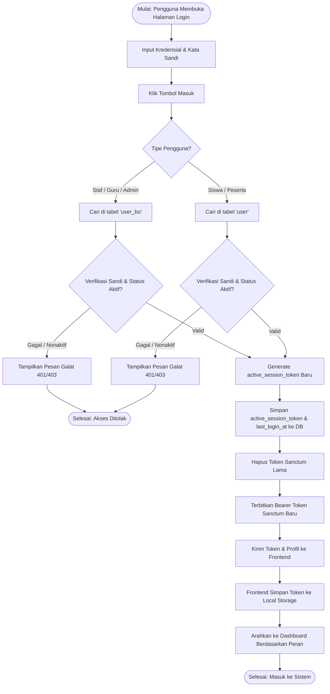
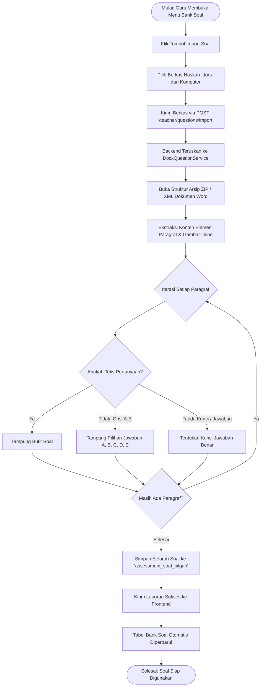
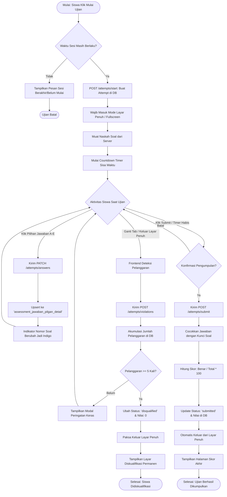
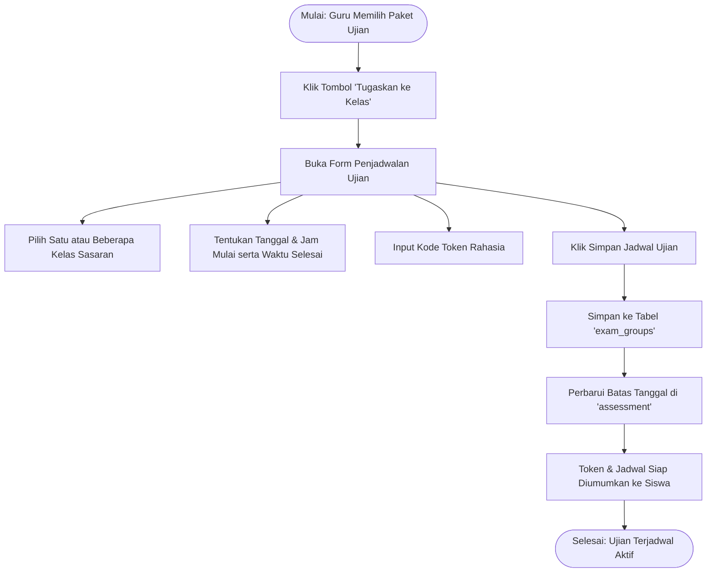

# 07. Activity Diagram
**Sistem CBT Ujian Online (Online Examination System)**  
*Pemodelan Alur Aktivitas Bisnis Sistem Berdasarkan Alur Faktual Kode Program*

---

## 1. Activity Diagram: Autentikasi Pengguna & Single-Session Lock

Diagram ini memodelkan proses verifikasi identitas, penerbitan token sesi, dan pemutusan sesi di perangkat lain (*session kick*).

---

## 2. Activity Diagram: Impor Naskah Soal Word (.docx)

Diagram ini memodelkan alur kerja guru dalam mengunggah berkas soal Word dan proses parsing internal oleh `DocxQuestionService`.

---

## 3. Activity Diagram: Pengerjaan Ujian, Autosave, & Pengawasan Anti-Cheat

Diagram ini memodelkan interaksi siswa di ruang ujian, mekanisme penyimpanan jawaban per detik, serta penanganan pelanggaran proctoring.

---

## 4. Activity Diagram: Penjadwalan Ujian & Pembagian Token (Guru)

Diagram ini memodelkan alur guru dalam mengalokasikan paket ujian ke rombongan belajar kelas tertentu dan membagikan token akses.

