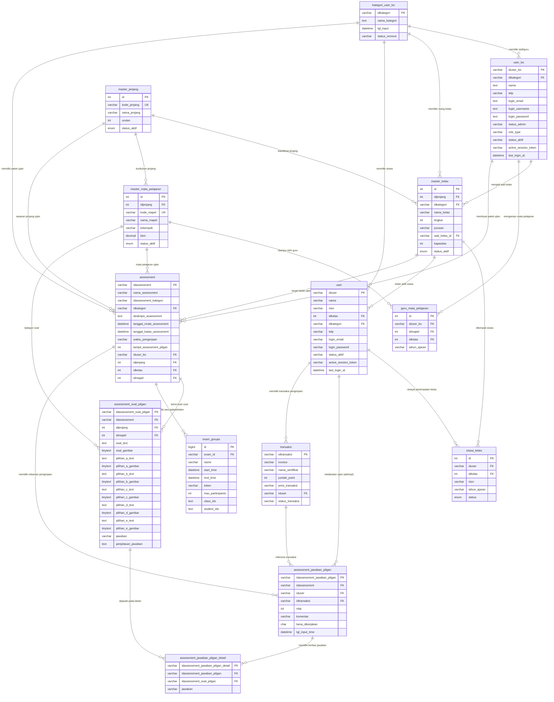

# 08. Entity Relationship Diagram (ERD) Documentation
**Sistem CBT Ujian Online (Online Examination System)**  
*Dokumentasi Relasi Basis Data Berdasarkan Skema Aktual MySQL `sertidemi`*

---

## 1. Visualisasi Entity Relationship Diagram (Mermaid)

---

## 2. Penjelasan Relasi & Kardinalitas Utama

### 2.1. Hirarki Multi-Tenant (`kategori_user_bo`)
- **1 Instansi memiliki Banyak Staf/Guru:** `kategori_user_bo (1) ── (N) user_bo` melalui kunci asing `user_bo.idkategori`.
- **1 Instansi memiliki Banyak Ruang Kelas:** `kategori_user_bo (1) ── (N) master_kelas` melalui `master_kelas.idkategori`.
- **1 Instansi memiliki Banyak Siswa:** `kategori_user_bo (1) ── (N) user` melalui `user.idkategori`.
- **1 Instansi memiliki Banyak Paket Ujian:** `kategori_user_bo (1) ── (N) assessment` melalui `assessment.idkategori`.

### 2.2. Struktur Akademik & Kelas
- **Jenjang ke Kelas & Mapel:** `master_jenjang (1) ── (N) master_kelas` dan `master_jenjang (1) ── (N) master_mata_pelajaran`.
- **Wali Kelas:** `user_bo (1) ── (N) master_kelas` melalui `master_kelas.wali_kelas_id` (*nullable*).
- **Penugasan Guru Mapel:** `guru_mata_pelajaran` berperan sebagai tabel relasi banyak-ke-banyak antara `user_bo`, `master_mata_pelajaran`, dan `master_kelas`.
- **Alokasi Siswa Kelas:** `siswa_kelas` mencatat riwayat penempatan `user` di dalam `master_kelas` per tahun ajaran.

### 2.3. Siklus Ujian & Autosave Jawaban
- **Paket Ujian ke Butir Soal:** `assessment (1) ── (N) assessment_soal_pilgan` melalui `idassessment`.
- **Sesi Penjadwalan Ujian:** `assessment (1) ── (N) exam_groups` melalui `exam_groups.exam_id`.
- **Sesi Pengerjaan Siswa (Attempt):** `assessment (1) ── (N) assessment_jawaban_pilgan` dan `user (1) ── (N) assessment_jawaban_pilgan`.
- **Keterikatan Transaksi:** `transaksi (1) ── (N) assessment_jawaban_pilgan` melalui `idtransaksi` (status transaksi bernilai '7' untuk akses ujian aktif).
- **Detail Lembar Jawaban Siswa:** `assessment_jawaban_pilgan (1) ── (N) assessment_jawaban_pilgan_detail` melalui `idassessment_jawaban_pilgan`. Setiap pilihan jawaban terhubung ke `assessment_soal_pilgan` melalui `idassessment_soal_pilgan`.
