# 12. Software Architecture Document (SAD)
**Sistem CBT Ujian Online (Online Examination System)**  
*Dokumentasi Arsitektur Perangkat Lunak, Pola Desain, dan Aliran Data Sistem*

---

## 1. Ikhtisar Arsitektur Tingkat Tinggi (High-Level Architecture)

Sistem CBT Ujian Online mengadopsi pola **Decoupled Client-Server Architecture** dengan pemisahan penuh antara antarmuka pengguna (*Client-Side Single Page Application*) dan logika pemrosesan data (*Server-Side Stateless RESTful API Engine*).

```mermaid
graph TB
    subgraph Client_Tier [Presentation Tier - React 19 SPA]
        Browser["🌐 Browser Klien (Desktop / Tablet)"]
        UI_Components["React Components & Tailwind CSS v4"]
        State_Cache["TanStack Query & React Context (Auth, Theme)"]
        Axios_Client["Axios HTTP Client + Interceptor (Bearer & X-Session-Token)"]
        KaTeX_Engine["KaTeX Math/Science Formula Engine"]
    end

    subgraph Security_Tier [API Gateway & Security Layer]
        Router["Laravel API Router (/api/...)"]
        Throttle_MW["Burst Rate Limiter (180 req/m Autosave, 30 req/m Login)"]
        Sanctum_Auth["Laravel Sanctum Authenticator"]
        Session_MW["EnsureSingleSession Middleware (X-Session-Token Check)"]
        Role_MW["CheckRole Middleware (super_admin, admin, guru, siswa)"]
    end

    subgraph Application_Tier [Business Logic & Controller Tier]
        Auth_Ctrl["Auth Controllers (LoginController, SessionController)"]
        Admin_Ctrl["Admin Controllers (Instansi, Jenjang, Kelas, Mapel, Siswa)"]
        Teacher_Ctrl["Teacher Controllers (Bank Soal, Generator 50 Acak, Sesi Token)"]
        Student_Ctrl["Student Controllers (ExamAttempt, AnswerAutosave, Result)"]
        Proctor_Ctrl["Proctoring Controller (ViolationLog, AutoDisqualification)"]
        Services["Domain Services (DocxQuestionService, AutoGradingService)"]
    end

    subgraph Persistence_Tier [Data Access & Database Tier]
        Eloquent_ORM["Eloquent ORM Models (UserBo, UserSiswa, Assessment, dll)"]
        MySQL_DB[("🗄️ MySQL Database: sertidemi")]
        File_Storage["Local Storage (File Naskah Soal & Media Gambar)"]
    end

    %% Hubungan Antar Tier
    Browser --> UI_Components
    UI_Components --> State_Cache
    State_Cache --> Axios_Client
    UI_Components --> KaTeX_Engine
    Axios_Client -->|HTTP/JSON REST Request| Router

    Router --> Throttle_MW
    Throttle_MW --> Sanctum_Auth
    Sanctum_Auth --> Session_MW
    Session_MW --> Role_MW

    Role_MW --> Auth_Ctrl
    Role_MW --> Admin_Ctrl
    Role_MW --> Teacher_Ctrl
    Role_MW --> Student_Ctrl
    Role_MW --> Proctor_Ctrl

    Teacher_Ctrl --> Services
    Student_Ctrl --> Services

    Auth_Ctrl --> Eloquent_ORM
    Admin_Ctrl --> Eloquent_ORM
    Teacher_Ctrl --> Eloquent_ORM
    Student_Ctrl --> Eloquent_ORM
    Proctor_Ctrl --> Eloquent_ORM
    Services --> Eloquent_ORM

    Eloquent_ORM -->|SQL Queries PDO| MySQL_DB
    Services -->|File I/O Parsing| File_Storage
```



---

## 2. Rincian Lapisan Arsitektur (Architectural Layers)

### 2.1. Lapisan Presentasi (Presentation Tier - Frontend)
- **Teknologi:** React 19.x, TypeScript, Vite 8.x, Tailwind CSS v4.
- **Pola Desain:** *Component-Based Architecture* berbasis *Feature Folders*.
- **Manajemen State:**
  - `AuthContext`: Menyimpan status autentikasi, profil user aktif, token Sanctum, dan `session_token`.
  - `TanStack Query`: Menangani caching server state, pre-fetching daftar ujian, dan sinkronisasi data tanpa re-fetch berlebih.
- **Pustaka Formula:** `KaTeX` dirender secara klien untuk persamaan matematika tanpa membebani server backend.
- **Komunikasi Data:** Axios Interceptor secara otomatis menginjeksi header `Authorization: Bearer <token>` dan `X-Session-Token: <session_token>` pada setiap permintaan jaringan.

### 2.2. Lapisan Keamanan & Gateway (Security & Routing Tier)
- **Rate Limiting:** Menggunakan pembatas laju bawaan Laravel untuk mengantisipasi *burst concurrency*. Rute autosave diatur hingga `throttle:180,1` (180 request/menit).
- **Stateless Token Verification:** Laravel Sanctum memverifikasi validitas token pada tabel `personal_access_tokens`.
- **Single-Session Enforcement (`EnsureSingleSession`):** Mencegah akun siswa digunakan secara simultan di dua browser berbeda. Jika nilai `X-Session-Token` tidak cocok dengan rekaman `active_session_token` di database, sesi lama otomatis dicabut (*session overwrite*).
- **Role-Based Access Control (`CheckRole`):** Memvalidasi hak akses hierarkis berdasarkan tipe peran: `super_admin`, `admin`, `guru`, dan `siswa`.

### 2.3. Lapisan Logika Bisnis & Layanan (Business Logic Tier)
- **Skinny Controllers:** Controller bertugas melakukan validasi input request, memanggil model/service yang relevan, dan mengembalikan respon JSON standar.
- **Dedicated Domain Services:**
  - `DocxQuestionService`: Mengekstrak struktur teks, gambar inline, dan pilihan jawaban dari berkas Microsoft Word (`.docx`).
  - `AutoGradingService`: Membandingkan opsi pilihan jawaban siswa di `assessment_jawaban_pilgan_detail` dengan kunci jawaban di `assessment_soal_pilgan` untuk menghasilkan skor total.

### 2.4. Lapisan Akses Data & Persistensi (Data Access & Persistence Tier)
- **Eloquent ORM:** Menyediakan antarmuka interaksi objek dengan basis data relasional MySQL `sertidemi`.
- **Penanganan Kunci Primer Non-Standar:** Model-model warisan Sertidemi (`Assessment`, `UserBo`, `UserSiswa`, `AssessmentJawabanPilgan`) dikonfigurasi dengan `$incrementing = false` dan `$keyType = 'string'` untuk menampung primary key unik berbasis timestamp/string angka.

---

## 3. Desain Pipa Konkurensi & Autosave (Concurrency & Autosave Pipeline)

Aliran data autosave jawaban siswa dirancang untuk menahan beban tinggi saat ratusan siswa serentak mengerjakan ujian:

```
[Siswa Klik Opsi Jawaban (Frontend)]
              │
              ▼
[Debounce / Immediate Dispatch via Axios]
              │ (HTTP PATCH /student/attempts/{id}/answers)
              ▼
[Rate Limiter (Throttle: 180 req/menit)]
              │ (Lolos verifikasi kuota)
              ▼
[EnsureSingleSession Middleware]
              │ (Lolos verifikasi session token)
              ▼
[AnswerController::saveAnswer]
              │
              ▼
[Atomic UPSERT Query ke 'assessment_jawaban_pilgan_detail']
   INSERT INTO assessment_jawaban_pilgan_detail (...)
   VALUES (...)
   ON DUPLICATE KEY UPDATE jawaban = VALUES(jawaban)
              │
              ▼
[HTTP 200 OK Response < 100ms]
              │
              ▼
[Indikator Nomor Soal Tercentang Hijau/Indigo di Layar Siswa]
```

---

## 4. Pola Multi-Tenancy (Data Isolation Strategy)

Sistem menggunakan strategi **Shared Database, Shared Schema, Scoped Tenant**:
1. Seluruh instansi berbagi satu database fisik (`sertidemi`).
2. Setiap entitas data sekolah (kelas, siswa, mapel, ujian) memiliki kolom kunci referensi `idkategori`.
3. Pada level controller (`InstansiController`, `TeacherExamController`, `DashboardController`), query SQL otomatis menginjeksi klausa:
   ```sql
   WHERE idkategori = '{user.idkategori}'
   ```
   kecuali pengguna yang sedang login berstatus `super_admin`. Strategi ini menjamin efisiensi infrastruktur lokal tanpa mengorbankan privasi data masing-masing sekolah.
