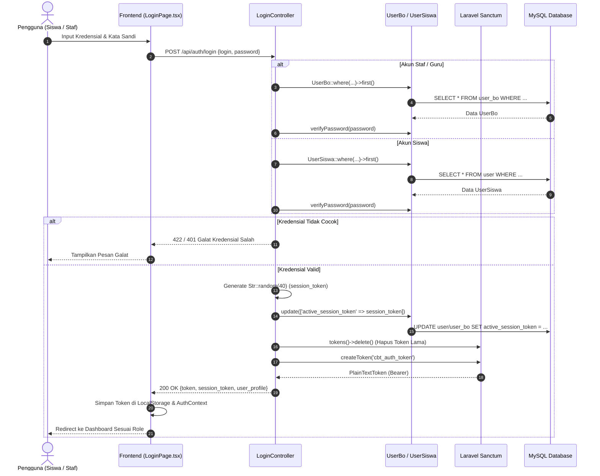
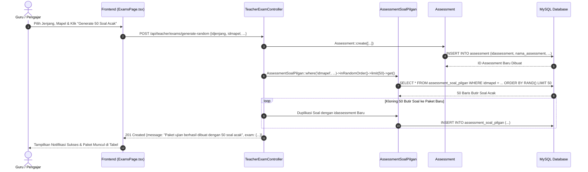
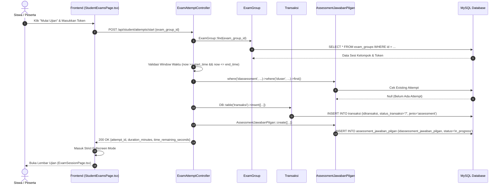
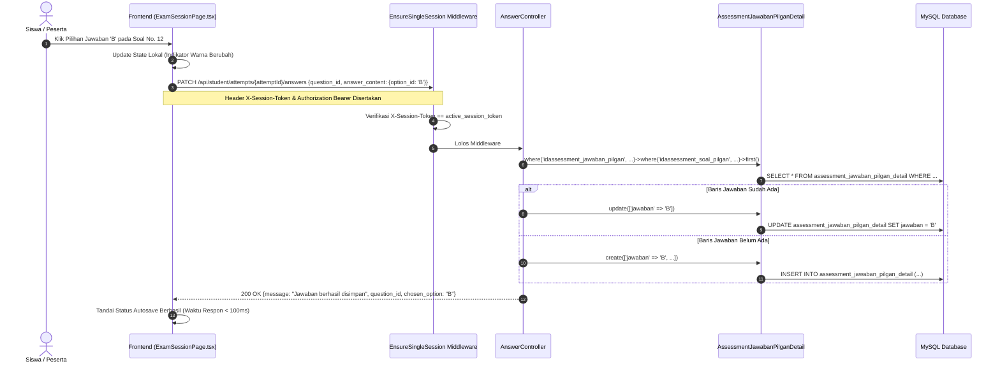
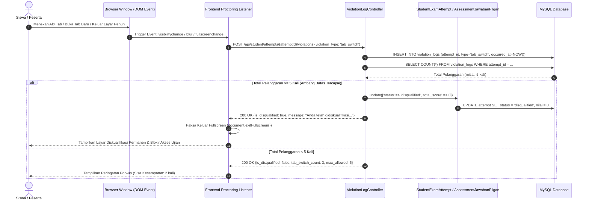
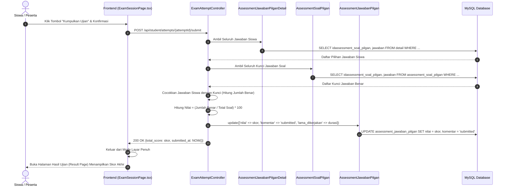

# 13. Sequence Diagram
**Sistem CBT Ujian Online (Online Examination System)**  
*Pemodelan Urutan Interaksi Objek Berdasarkan Alur Eksekusi Kode Faktual*

---

## 1. Sequence Diagram 1: Autentikasi & Single-Session Token Locking

Diagram ini memodelkan proses verifikasi kata sandi dual-entitas, pembentukan token sesi, dan pencegahan duplikasi akun.

---

## 2. Sequence Diagram 2: Generator 50 Soal Acak (Guru)

Diagram ini memodelkan proses pengambilan 50 butir soal acak dari bank soal dan pembuatan paket ujian baru.

---

## 3. Sequence Diagram 3: Inisialisasi Ujian Siswa (Start Attempt)

Diagram ini memodelkan validasi jadwal, pembuatan record transaksi pendukung, dan pembentukan sesi pengerjaan ujian.

---

## 4. Sequence Diagram 4: Real-Time Autosave Jawaban Siswa

Diagram ini memodelkan penyimpanan instan setiap pilihan jawaban yang diklik siswa ke tabel detail.

---

## 5. Sequence Diagram 5: Deteksi Pelanggaran Proctoring & Auto-Diskualifikasi

Diagram ini memodelkan pencatatan insiden perpindahan tab/jendela dan pemutusan ujian otomatis saat melebihi batas.

---

## 6. Sequence Diagram 6: Penyerahan Ujian & Auto-Grading

Diagram ini memodelkan proses akhir pengumpulan ujian dan penghitungan skor otomatis.

