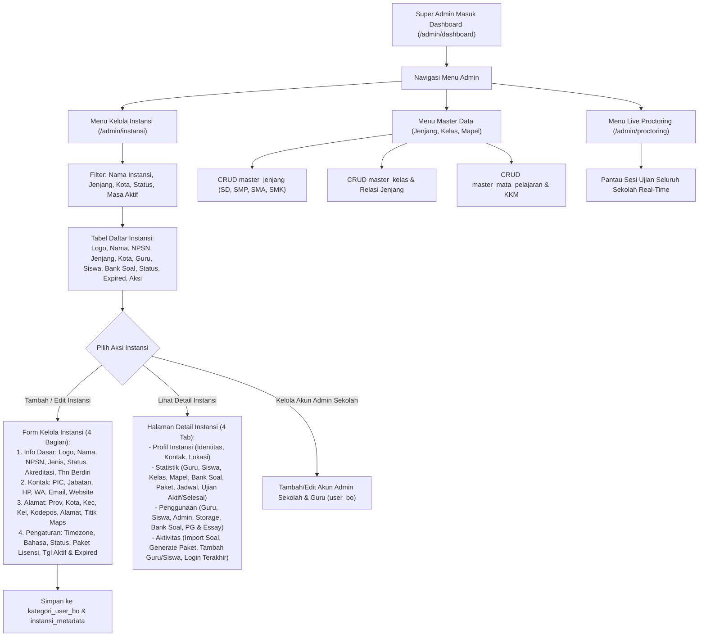
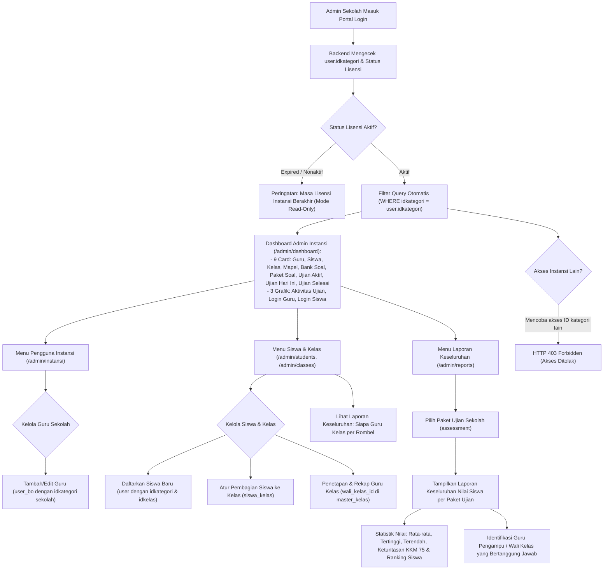
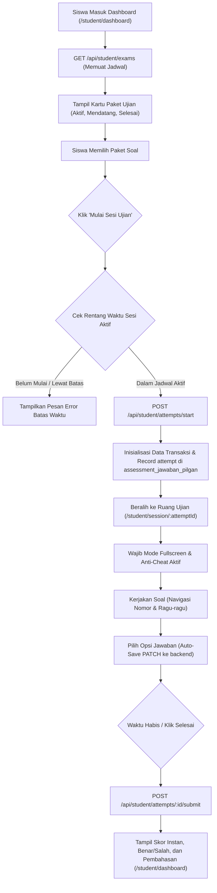
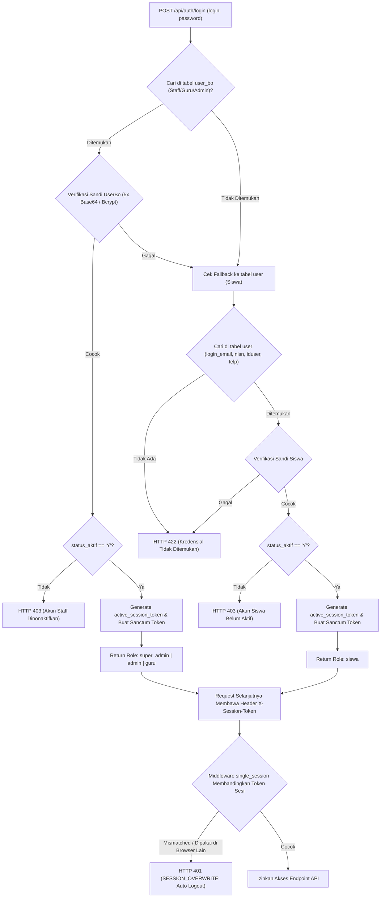
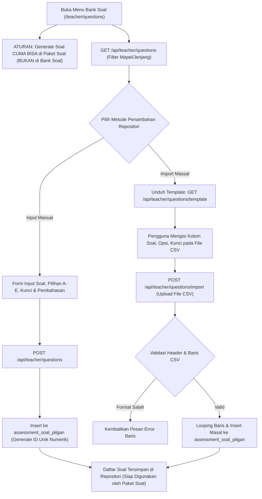
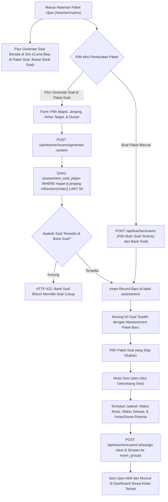
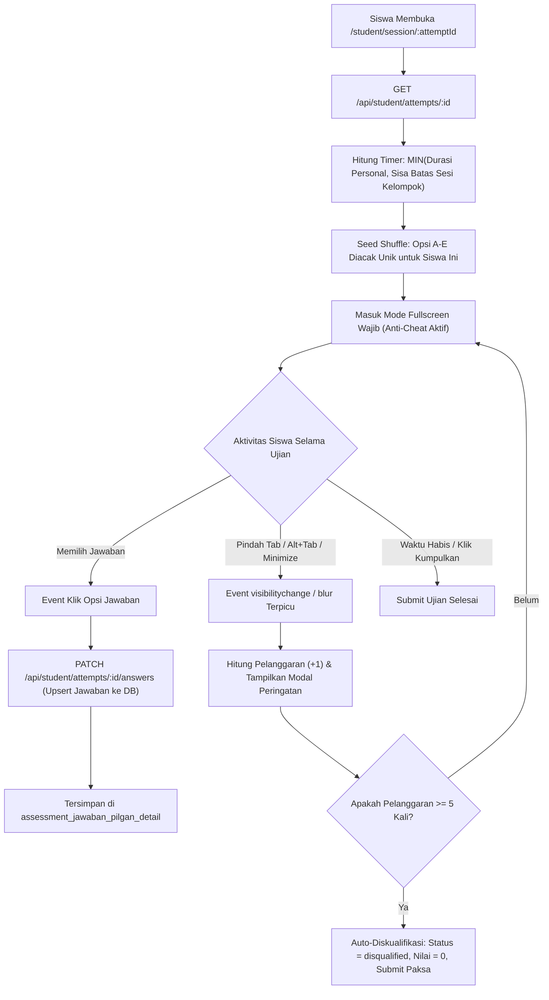
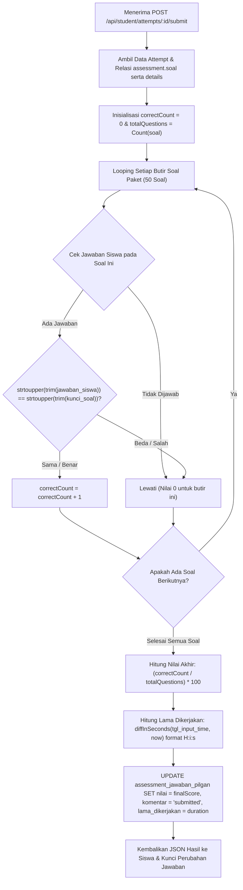
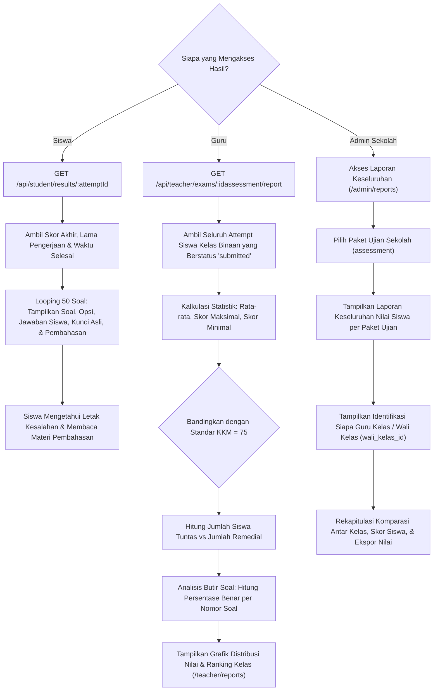

# Dokumentasi Flowchart Sistem CBT Ujian Online

**Proyek:** Sistem CBT Ujian Online (Online Examination System)  
**Konteks Basis Data:** MySQL `sertidemi` (Laragon Local Environment)  
**Dasar Pemodelan:** 100% Berdasarkan Faktual *Source Code* (Backend Laravel 12 & Frontend React 19 SPA)  
**Status Dokumen:** Dokumen Resmi Rekayasa Perangkat Lunak (System Flowchart Specification)

---

## ⚠️ Temuan Perbedaan Antara Flow Bisnis dan Implementasi Source Code

Berdasarkan audit faktual kode sumber dan struktur basis data `sertidemi`, ditemukan beberapa catatan teknis penting:

1. **Model Siswa pada Violation Logging (Proctoring/Anti-Cheat):**
   * *Kondisi Aktual:* Siswa diautentikasi menggunakan model [UserSiswa](file:///d:/MAGANG/exam/Sistem-Ujian-Online/backend/app/Models/UserSiswa.php) (tabel `user`), sedangkan di [ViolationLogController.php](file:///d:/MAGANG/exam/Sistem-Ujian-Online/backend/app/Http/Controllers/Api/Proctoring/ViolationLogController.php#L22) memanggil `$request->user()->student` (relasi milik model Laravel `User` default).
   * *Perilaku Lapangan:* Pada sisi klien ([ExamSessionPage.tsx](file:///d:/MAGANG/exam/Sistem-Ujian-Online/frontend/src/features/student/ExamSessionPage.tsx)), penghitungan batas Alt+Tab (`max_tab_switches = 5`) dieksekusi secara lokal di state peramban siswa, sehingga diskualifikasi tetap berjalan di browser siswa meskipun request background sync ke controller tersebut menghasilkan error.
   * **[Perlu Konfirmasi]**: Apakah controller proctoring perlu disinkronkan ke tabel `assessment_jawaban_pilgan` agar pencatatan di database server konsisten dengan tabel `user` SertiDemi?

2. **Rute Unduh Template Naskah Word (.docx):**
   * *Kondisi Aktual:* Antarmuka [QuestionImportModal.tsx](file:///d:/MAGANG/exam/Sistem-Ujian-Online/frontend/src/features/teacher/components/QuestionImportModal.tsx) memiliki fungsi pemanggilan ke endpoint `/teacher/questions/template/word`, dan service [DocxQuestionService.php](file:///d:/MAGANG/exam/Sistem-Ujian-Online/backend/app/Services/DocxQuestionService.php) telah tersedia di backend. Namun pada [routes/api.php](file:///d:/MAGANG/exam/Sistem-Ujian-Online/backend/routes/api.php), rute yang saat ini aktif dipetakan ke controller adalah `/teacher/questions/template` (format CSV/Excel).
   * **[Perlu Konfirmasi]**: Apakah rute download template dan impor naskah Word (.docx) perlu diaktifkan pada file `api.php`?

3. **Mekanisme Otomatis Pengisian Soal (*Fallback Auto-Populate*):**
   * *Kondisi Aktual:* Pada [ExamAttemptController.php](file:///d:/MAGANG/exam/Sistem-Ujian-Online/backend/app/Http/Controllers/Api/Student/ExamAttemptController.php#L258-L297), apabila seorang siswa memulai sesi ujian pada paket yang belum dikaitkan dengan butir soal, backend secara otomatis menyalin (*clone*) hingga 50 butir soal dari bank soal yang sesuai dengan jenjang dan mapel paket tersebut agar lembar ujian siswa tidak kosong.

---

# 1. Overall System Flow: Flow Gabungan 4 User Terintegrasi (Cross-Functional Swimlane)

### Metadata Flow
* **Tujuan Flow:** Memodelkan arsitektur operasional end-to-end terpadu yang menghubungkan 4 peran pengguna (*Super Admin, Admin Sekolah/Instansi, Guru, dan Siswa*) dalam satu siklus hidup ujian CBT (*Computer-Based Test*), mulai dari inisialisasi master data pendidikan, penugasan guru kelas, pembuatan paket soal, pembukaan sesi ujian, pengerjaan berproteksi anti-cheat, hingga evaluasi laporan nilai terpusat.
* **Aktor Terlibat (4 User):**
  1. **Super Admin IP:** Pengelola induk sistem multi-tenant dan konfigurasi master global nasional.
  2. **Admin Sekolah / Instansi:** Pengelola tenant sekolah, pembagian kelas, penetapan guru kelas/wali kelas, dan pemantau laporan keseluruhan sekolah.
  3. **Guru / Tenaga Pendidik:** Penyusun bank soal, pembuat paket ujian (fitur generate soal), pelaksana sesi ujian, dan evaluator butir soal.
  4. **Siswa / Peserta Ujian:** Peserta ujian yang memilih paket soal terjadwal, menjalankan sesi pengerjaan, dan menerima umpan balik nilai.
* **Trigger Awal:** Pengguna mengakses portal sistem terpadu (`/login`) sesuai kredensial masing-masing.
* **Interkoneksi Siklus Hidup Ujian (End-to-End):**
  - **Super Admin** mendaftarkan instansi (`kategori_user_bo`) dan membuat akun Admin Sekolah.
  - **Admin Sekolah** mendaftarkan guru (`user_bo`), mengonfigurasi rombel & menetapkan **Wali/Guru Kelas** (`master_kelas`), serta mendaftarkan siswa (`user`, `siswa_kelas`).
  - **Guru** mengelola Bank Soal (input/impor) -> Masuk Paket Soal -> Menjalankan **Fitur Generate Soal** (hanya di paket soal, bukan bank soal) atau rakit manual -> **Memilih Paket Soal** -> Melakukan aksi **Mulai Sesi Ujian** (menetapkan nama sesi gelombang, batas waktu, dan kelas peserta di `exam_groups`).
  - **Siswa** masuk dashboard -> **Memilih Paket Soal** yang ditugaskan -> Klik **"Mulai Sesi Ujian"** -> Validasi waktu sesi aktif -> Pengerjaan Fullscreen + Anti-Cheat + Autosave -> Submit Ujian.
  - **Sistem Auto-Grading Engine** menghitung skor instan skala 100 secara sinkron.
  - **Data Hasil Ujian Mengalir ke 3 Aktor:**
    1. *Siswa:* Skor instan dan pembahasan materi.
    2. *Guru:* Rekap nilai kelas, analisis butir soal, dan persentase tuntas KKM 75.
    3. *Admin Sekolah:* **Laporan Keseluruhan** yang menyajikan pemetaan siapa guru kelas dan capaian nilai siswa per paket ujian lintas kelas.
* **File Source Code Dasar:**
  * [frontend/src/App.tsx](file:///d:/MAGANG/exam/Sistem-Ujian-Online/frontend/src/App.tsx)
  * [backend/app/Http/Controllers/Api/Auth/LoginController.php](file:///d:/MAGANG/exam/Sistem-Ujian-Online/backend/app/Http/Controllers/Api/Auth/LoginController.php)
  * [backend/app/Http/Controllers/Api/Admin/InstansiController.php](file:///d:/MAGANG/exam/Sistem-Ujian-Online/backend/app/Http/Controllers/Api/Admin/InstansiController.php)
  * [backend/app/Http/Controllers/Api/Admin/MasterKelasController.php](file:///d:/MAGANG/exam/Sistem-Ujian-Online/backend/app/Http/Controllers/Api/Admin/MasterKelasController.php)
  * [backend/app/Http/Controllers/Api/Teacher/TeacherExamController.php](file:///d:/MAGANG/exam/Sistem-Ujian-Online/backend/app/Http/Controllers/Api/Teacher/TeacherExamController.php)
  * [backend/app/Http/Controllers/Api/Student/ExamAttemptController.php](file:///d:/MAGANG/exam/Sistem-Ujian-Online/backend/app/Http/Controllers/Api/Student/ExamAttemptController.php)
* **Tabel Database Terintegrasi:** `kategori_user_bo`, `user_bo`, `user`, `master_jenjang`, `master_kelas`, `siswa_kelas`, `assessment`, `assessment_soal_pilgan`, `exam_groups`, `assessment_jawaban_pilgan`, `assessment_jawaban_pilgan_detail`.

```mermaid
flowchart TD
    %% ==========================================
    %% SUBGRAPH 1: SUPER ADMIN
    %% ==========================================
    subgraph SA["1. SUPER ADMIN (Global Administrator)"]
        SA_LOGIN["Login Super Admin (/login)"] --> SA_DASH["Dashboard Global (/admin/dashboard)"]
        SA_DASH --> SA_MASTER["CRUD Master Data Global:<br/>Jenjang, Tingkat, Mapel, KKM"]
        SA_DASH --> SA_INST_LIST["List & Multi-Filter Instansi (/admin/instansi)"]
        SA_INST_LIST --> SA_INST_FORM["Form Kelola Instansi (Wizard 4 Bagian:<br/>Info Dasar, Kontak, Alamat, Lisensi)"]
        SA_INST_LIST --> SA_INST_DET["Detail Instansi (4 Tab:<br/>Profil, Statistik, Penggunaan, Aktivitas)"]
        SA_INST_FORM --> SA_CREATE_ADMIN["Terbitkan Akun Admin Sekolah<br/>(user_bo dengan role: admin)"]
        SA_DASH --> SA_MONITOR["Supervisi Live Proctoring Nasional"]
    end

    %% ==========================================
    %% SUBGRAPH 2: ADMIN SEKOLAH
    %% ==========================================
    subgraph AS["2. ADMIN SEKOLAH / INSTANSI (Tenant Operator)"]
        AS_LOGIN["Login Admin Sekolah (Terikat idkategori & Cek Lisensi)"] --> AS_DASH["Dashboard Sekolah (/admin/dashboard):<br/>9 Card Statistik & 3 Grafik Tren"]
        AS_DASH --> AS_TEACHERS["Kelola Akun Guru Lokal<br/>(user_bo role: guru)"]
        AS_DASH --> AS_CLASSES["Kelola Rombel & Tetapkan Guru Kelas<br/>(master_kelas.wali_kelas_id)"]
        AS_DASH --> AS_STUDENTS["Pendaftaran Siswa & Penempatan Kelas<br/>(user, siswa_kelas)"]
        
        AS_DASH --> AS_REPORTS["Menu Laporan Keseluruhan (/admin/reports)"]
        AS_REPORTS --> AS_REP_VIEW["Pantau Laporan Keseluruhan:<br/>1. Pemetaan Siapa Guru Kelas per Rombel<br/>2. Rekap Nilai Siswa per Paket Ujian"]
    end

    %% ==========================================
    %% SUBGRAPH 3: GURU
    %% ==========================================
    subgraph G["3. GURU / PENGAJAR (Evaluator & Fasilitator)"]
        G_LOGIN["Login Guru (/login)"] --> G_DASH["Portal Guru (/teacher/dashboard)"]
        
        G_DASH --> G_BS["Bank Soal (/teacher/questions)<br/>Input Satuan / Impor File CSV-Word<br/><i>(ATURAN: Tanpa Fitur Generate)</i>"]
        G_DASH --> G_EXAM["Paket TryOut & Ujian (/teacher/exams)"]
        
        G_EXAM --> G_METHOD{"Pilih Metode Isi Paket"}
        G_METHOD -->|Fitur Generate Soal (HANYA di Paket Soal)| G_AUTO["Generate 50 Soal Acak dari Bank Soal<br/>(inRandomOrder LIMIT 50)"]
        G_METHOD -->|Penyusunan Manual| G_MANUAL["Pilih Butir Soal Tertentu dari Bank Soal"]
        
        G_AUTO --> G_PKG["Paket Soal Terbentuk & Kloning Butir Soal<br/>(tabel assessment)"]
        G_MANUAL --> G_PKG
        
        G_PKG --> G_CHOOSE["Guru Memilih Paket Soal"]
        G_CHOOSE --> G_SESSION["Mulai Sesi Ujian (Atur Gelombang Sesi):<br/>Input Nama Sesi, Jadwal Mulai-Selesai, & Kelas Peserta"]
        G_SESSION --> G_ACTIVE["Sesi Ujian Aktif Diterbitkan<br/>(exam_groups)"]
        
        G_DASH --> G_REPORTS["Laporan Nilai (/teacher/reports):<br/>Rekap Kelas, Analisis Butir Soal, Daya Beda"]
    end

    %% ==========================================
    %% SUBGRAPH 4: SISWA
    %% ==========================================
    subgraph S["4. SISWA / PESERTA UJIAN (Testee)"]
        S_LOGIN["Login Siswa (NISN / Email / No. Telp)"] --> S_DASH["Portal Siswa (/student/dashboard)"]
        S_DASH --> S_EXAM_LIST["Lihat Daftar Kartu Ujian Terjadwal"]
        S_EXAM_LIST --> S_SELECT["Siswa Memilih Paket Soal"]
        S_SELECT --> S_START{"Klik 'Mulai Sesi Ujian'"}
        
        S_START --> S_TIME_CHECK{"Validasi Rentang Jadwal Sesi"}
        S_TIME_CHECK -->|Belum Dibuka / Lewat Batas| S_BLOCK["Peringatan: Sesi Belum/Sudah Berakhir"]
        S_TIME_CHECK -->|Dalam Jadwal Aktif| S_INIT["POST /attempts/start (Inisialisasi Attempt)"]
        
        S_INIT --> S_ROOM["Ruang Ujian Fullscreen (/student/session/:attemptId)"]
        S_ROOM --> S_WORK["Pengerjaan Soal (Navigasi Nomor & Ragu-ragu)"]
        S_WORK --> S_AUTOSAVE["Auto-Save Opsi Jawaban per Klik<br/>(PATCH assessment_jawaban_pilgan_detail)"]
        S_ROOM --> S_PROCTOR["Anti-Cheat: Deteksi Alt+Tab / Blur Layar<br/>(Toleransi Maksimal 5x)"]
        
        S_WORK --> S_SUBMIT{"Waktu Habis / Klik Kumpulkan"}
        S_SUBMIT --> S_POST_SUBMIT["POST /attempts/:id/submit"]
        S_POST_SUBMIT --> S_RESULT["Tinjau Hasil: Skor Instan, Benar/Salah, & KaTeX Pembahasan"]
    end

    %% ==========================================
    %% SUBGRAPH 5: BACKEND & DATABASE
    %% ==========================================
    subgraph BACKEND["SISTEM ENGINE & BASIS DATA (sertidemi)"]
        ENG_GRADE["Auto-Grading Engine:<br/>Pencocokan Jawaban Sinkron & Penskoran Skala 100"]
        DB_MAIN[("Basis Data MySQL sertidemi:<br/>assessment, user, assessment_jawaban_pilgan")]
    end

    %% ==========================================
    %% RELASI & ALIRAN DATA ANTAR 4 USER
    %% ==========================================
    %% 1. Dari Super Admin ke Admin Sekolah
    SA_CREATE_ADMIN -.->|Terbitkan Akun Admin & Hak Akses Instansi| AS_LOGIN

    %% 2. Dari Admin Sekolah ke Guru & Siswa
    AS_TEACHERS -.->|Terbitkan Akun Guru| G_LOGIN
    AS_CLASSES -.->|Tetapkan Penugasan Guru/Wali Kelas| G_DASH
    AS_STUDENTS -.->|Terbitkan Akun Siswa & Kelas Belajar| S_LOGIN

    %% 3. Aliran Konten Soal dari Guru ke Siswa
    G_BS -.->|Sumber Pustaka Soal| G_METHOD
    G_ACTIVE ==>|Terbitkan Jadwal Sesi Ujian ke Kelas Terdaftar| S_EXAM_LIST

    %% 4. Pengerjaan Siswa ke Engine Backend
    S_AUTOSAVE --> DB_MAIN
    S_POST_SUBMIT --> ENG_GRADE
    ENG_GRADE --> DB_MAIN

    %% 5. Distribusi Laporan Hasil dari Database ke Pengguna
    DB_MAIN ==>|Review Hasil Individu & Pembahasan| S_RESULT
    DB_MAIN ==>|Laporan Capaian Kelas & Analisis Daya Beda Butir Soal| G_REPORTS
    DB_MAIN ==>|Laporan Keseluruhan Sekolah: Siapa Guru Kelas & Nilai per Paket| AS_REP_VIEW
```

---

### Matriks Interaksi dan Aliran Data Antar 4 User

| Aktor Pengirim | Aktor Penerima | Entitas Data / Aksi yang Mengalir | Basis Data / Endpoint Terkait |
| :--- | :--- | :--- | :--- |
| **Super Admin** | **Admin Sekolah** | Pembuatan Instansi Sekolah Mitra & Akun Administrator Sekolah Lokal | `kategori_user_bo`, `user_bo` (`role: admin`) |
| **Super Admin** | **Seluruh Aktor** | Standarisasi Jenjang (SD/SMP/SMA/SMK), Mata Pelajaran, dan KKM Acuan (75) | `master_jenjang`, `master_mata_pelajaran` |
| **Admin Sekolah** | **Guru** | Registrasi Akun Pendidik & Penugasan sebagai **Wali/Guru Kelas** pada rombel tertentu | `user_bo` (`role: guru`), `master_kelas.wali_kelas_id` |
| **Admin Sekolah** | **Siswa** | Pendaftaran Akun Siswa (NISN/Email) & Penempatan ke Rombel Kelas | `user` (`role: siswa`), `siswa_kelas` |
| **Guru** | **Siswa** | Perakitan Paket Soal (*fitur Generate Soal hanya di paket soal*), lalu **Memulai Sesi Ujian** (`exam_groups`) dengan jadwal aktif | `assessment`, `assessment_soal_pilgan`, `exam_groups` |
| **Siswa** | **Guru** | Jawaban ujian siswa yang tersimpan otomatis dan disubmit untuk dievaluasi per butir soal | `assessment_jawaban_pilgan`, `assessment_jawaban_pilgan_detail` |
| **Sistem / DB** | **Siswa** | Tampilan skor seketika (*instant auto-grading score*), status kelulusan KKM, dan lembar pembahasan | `POST /api/student/attempts/:id/submit`, `GET /api/student/results/:attemptId` |
| **Sistem / DB** | **Guru** | Laporan statistik kelas, daftar peringkat siswa tuntas/remedial, dan daya pembeda butir soal | `GET /api/teacher/exams/:id/report` (`ExamReportPage.tsx`) |
| **Sistem / DB** | **Admin Sekolah** | **Laporan Keseluruhan Sekolah**: Pemetaan siapa guru kelas penanggung jawab rombel dan rekapitulasi nilai ujian siswa per paket ujian | `/admin/reports`, `/admin/classes`, `MasterKelasController` |

---

*Penjelasan Singkat Alur Gabungan:* Diagram di atas menyajikan gambaran utuh bagaimana sistem CBT berfungsi sebagai ekosistem kolaboratif: Super Admin menyediakan pondasi kelembagaan dan kurikulum, Admin Sekolah mengatur pembagian kelas dan menetapkan guru kelasnya, Guru merakit materi soal (dengan kebebasan mengenerate soal acak pada paket soal) lalu membuka sesinya, Siswa mengikuti ujian dengan proteksi integritas tinggi, dan sistem menutup rangkaian dengan menyajikan laporan komprehensif bagi Guru dan pimpinan Admin Sekolah.

---

# 2. Super Admin Flow

### Metadata Flow
* **Tujuan Flow:** Memfasilitasi Super Administrator dalam mengelola ekosistem multi-tenant instansi mitra, seluruh master data pendidikan, serta memantau ujian seluruh sekolah secara terpusat.
* **Aktor:** Super Admin IP (`role: super_admin`, `status_admin = '1'`).
* **Trigger:** Login sukses dengan akun super administrator.
* **Proses:** Membuka dashboard analitik instansi -> Akses menu instansi & pengguna -> Tambah/Edit Instansi Mitra (`kategori_user_bo`) -> Kelola Admin Cabang & Guru -> Konfigurasi Jenjang, Kelas, Mapel -> Monitoring Ujian Berjalan.
* **Keputusan (Decision):** Apakah operasi CRUD instansi valid? Apakah data yang diubah memiliki ketergantungan relasi?
* **Output:** Instansi baru terdaftar, admin sekolah terbentuk, konfigurasi master pendidikan aktif secara global.
* **File Source Code Dasar:**
  * [AdminLayout.tsx](file:///d:/MAGANG/exam/Sistem-Ujian-Online/frontend/src/features/admin/AdminLayout.tsx)
  * [InstansiController.php](file:///d:/MAGANG/exam/Sistem-Ujian-Online/backend/app/Http/Controllers/Api/Admin/InstansiController.php)
  * [MasterJenjangController.php](file:///d:/MAGANG/exam/Sistem-Ujian-Online/backend/app/Http/Controllers/Api/Admin/MasterJenjangController.php)
  * [MasterKelasController.php](file:///d:/MAGANG/exam/Sistem-Ujian-Online/backend/app/Http/Controllers/Api/Admin/MasterKelasController.php)
  * [MasterMataPelajaranController.php](file:///d:/MAGANG/exam/Sistem-Ujian-Online/backend/app/Http/Controllers/Api/Admin/MasterMataPelajaranController.php)
* **Tabel Database yang Digunakan:** `kategori_user_bo`, `user_bo`, `master_jenjang`, `master_kelas`, `master_mata_pelajaran`, `assessment`.



*Penjelasan Singkat:* Super Admin tidak terikat batasan `idkategori` tertentu (`idkategori = null`), sehingga dapat melihat seluruh sekolah mitra melalui tabel kaya data dan filter multidimensi, mengelola profil instansi secara mendalam (Informasi Dasar, Kontak, Alamat, dan Pengaturan Lisensi), memantau 360° Detail Instansi (Profil, Statistik, Penggunaan, dan Aktivitas), membuat akun pimpinan sekolah, serta mengonfigurasi standar akademik nasional.

---

# 3. Admin Instansi Flow

### Metadata Flow
* **Tujuan Flow:** Memfasilitasi Admin Sekolah dalam mengelola operasional internal sekolahnya sendiri (guru pengajar, siswa, rombongan belajar kelas), memantau **Dashboard 9 Kartu Statistik & 3 Grafik Tren**, serta meninjau **laporan keseluruhan sekolah**: pemetaan **siapa guru kelas** (wali kelas/pengampu) dan **rekapitulasi nilai ujian siswa per paket ujian**.
* **Aktor:** Admin Sekolah / Instansi (`role: admin`, `role_type = 'admin_sekolah'`).
* **Trigger:** Login sukses dengan akun admin sekolah yang terikat dengan satu `idkategori`.
* **Proses:** Validasi isolasi data instansi (`WHERE idkategori = user.idkategori`) -> Cek masa aktif lisensi instansi -> Masuk Dashboard dengan 9 card statistik (Total Guru, Siswa, Kelas, Mapel, Bank Soal, Paket Soal, Ujian Aktif, Ujian Hari Ini, Ujian Selesai) dan 3 grafik (Aktivitas Ujian, Login Guru, Login Siswa) -> Pengelolaan akun guru lokal -> Pendaftaran & impor data siswa -> Penempatan siswa ke kelas instansi -> Penugasan guru kelas / wali kelas -> Akses Laporan Keseluruhan (`/admin/reports` & `/admin/classes`) untuk melihat siapa guru kelas dan capaian nilai siswa per paket ujian -> Monitoring sesi ujian lokal.
* **Keputusan (Decision):** Apakah masa aktif lisensi instansi valid? Apakah entitas yang diakses berada di bawah `idkategori` miliknya? (Jika berbeda, sistem mengembalikan HTTP 403 Forbidden).
* **Output:** Akun guru dan siswa terdaftar pada instansi terkait, pembagian kelas valid, metrik dashboard instansi terpantau, laporan keseluruhan pemetaan guru kelas, dan rekapitulasi nilai siswa per paket ujian.
* **File Source Code Dasar:**
  * [InstansiController.php](file:///d:/MAGANG/exam/Sistem-Ujian-Online/backend/app/Http/Controllers/Api/Admin/InstansiController.php#L34-L59) (method `authorizeInstansi`)
  * [StudentController.php](file:///d:/MAGANG/exam/Sistem-Ujian-Online/backend/app/Http/Controllers/Api/Admin/StudentController.php#L19-L21)
  * [TeacherController.php](file:///d:/MAGANG/exam/Sistem-Ujian-Online/backend/app/Http/Controllers/Api/Admin/TeacherController.php)
  * [MasterKelasController.php](file:///d:/MAGANG/exam/Sistem-Ujian-Online/backend/app/Http/Controllers/Api/Admin/MasterKelasController.php)
  * [ExamReportPage.tsx](file:///d:/MAGANG/exam/Sistem-Ujian-Online/frontend/src/features/teacher/ExamReportPage.tsx)
  * [ClassesPage.tsx](file:///d:/MAGANG/exam/Sistem-Ujian-Online/frontend/src/features/admin/ClassesPage.tsx)
* **Tabel Database yang Digunakan:** `user_bo`, `user`, `master_kelas`, `siswa_kelas`, `assessment`, `assessment_jawaban_pilgan`, `kategori_user_bo`.



*Penjelasan Singkat:* Admin Instansi beroperasi di lingkungan *multi-tenant* yang terisolasi. Seluruh aksi query CRUD secara otomatis dibatasi oleh `user.idkategori`. Pada dashboard, Admin Instansi disajikan 9 kartu statistik dan 3 grafik tren real-time. Selain mengelola data guru, siswa, dan rombel, Admin Sekolah memiliki kewenangan melihat laporan keseluruhan sekolah, mencakup pemetaan siapa guru kelas pada tiap rombel serta rekapitulasi nilai ujian siswa per paket ujian untuk evaluasi mutu akademik.

---

# 4. Guru Flow

### Metadata Flow
* **Tujuan Flow:** Menyediakan alur kerja pengajar dalam menyiapkan materi butir soal, membuat paket ujian terstruktur atau instan, memulai sesi ujian setelah memilih paket soal, menerbitkan jadwal ke kelas binaan, dan mengevaluasi hasil ujian.
* **Aktor:** Guru / Pengajar (`role: guru`).
* **Trigger:** Login sukses dengan akun guru (`user_bo`).
* **Proses:** 
  1. Membuka Bank Soal -> Input butir soal satuan atau impor file CSV/Word (**Catatan Penting: Fitur Generate Soal TIDAK BISA dilakukan di Bank Soal**).
  2. Membuka Menu Paket Ujian -> Menentukan metode pengisian paket:
     - **Fitur Generate Soal (HANYA BISA di Paket Soal)**: Mengacak 50 butir soal secara otomatis dari bank soal berdasarkan jenjang dan mapel.
     - Atau penyusunan paket manual (memilih butir soal spesifik dari bank soal).
  3. Menyimpan paket ujian ke database (`assessment`).
  4. **Memilih Paket Soal & Mulai Sesi Ujian**:
     - Guru memilih paket soal yang siap diujikan.
     - Mengklik "Tambah/Mulai Gelombang Sesi".
     - Mengatur nama sesi, waktu mulai pengerjaan, batas selesai pengerjaan, dan memilih kelas/siswa peserta.
  5. Sesi ujian aktif dan terbit otomatis di dashboard siswa.
  6. Membuka laporan hasil nilai ujian siswa per paket.
* **Keputusan (Decision):** 
  - Apakah membuat paket dengan fitur Generate 50 Soal Acak (fitur eksklusif di Paket Soal) atau menyusun secara manual?
  - Paket soal mana yang dipilih untuk dimulai sesinya?
  - Kelas dan rentang jadwal sesi mana yang ditetapkan?
* **Output:** Butir soal tersimpan di bank soal, paket soal terbentuk, sesi ujian berstatus aktif bagi siswa, dan laporan nilai ujian siswa per paket ujian.
* **File Source Code Dasar:**
  * [TeacherLayout.tsx](file:///d:/MAGANG/exam/Sistem-Ujian-Online/frontend/src/features/teacher/TeacherLayout.tsx)
  * [TeacherQuestionBankController.php](file:///d:/MAGANG/exam/Sistem-Ujian-Online/backend/app/Http/Controllers/Api/Teacher/TeacherQuestionBankController.php)
  * [TeacherExamController.php](file:///d:/MAGANG/exam/Sistem-Ujian-Online/backend/app/Http/Controllers/Api/Teacher/TeacherExamController.php)
  * [ExamGroupController.php](file:///d:/MAGANG/exam/Sistem-Ujian-Online/backend/app/Http/Controllers/Api/Teacher/ExamGroupController.php)
  * [ExamsPage.tsx](file:///d:/MAGANG/exam/Sistem-Ujian-Online/frontend/src/features/teacher/ExamsPage.tsx)
* **Tabel Database yang Digunakan:** `assessment_soal_pilgan`, `assessment`, `exam_groups`, `master_kelas`, `master_mata_pelajaran`, `assessment_jawaban_pilgan`.

```mermaid
flowchart TD
    G1["Guru Masuk Portal (/teacher/dashboard)"] --> G2["Pilih Menu Guru"]
    G2 --> G3["Bank Soal (/teacher/questions)"]
    G2 --> G4["Paket TryOut & Ujian (/teacher/exams)"]
    G2 --> G5["Laporan Nilai (/teacher/reports)"]

    G3 --> G6["Input Butir Soal Satuan / Import CSV/Word"]
    G6 --> G_BS_NOTE["(Catatan: Generate Soal BUKAN di Bank Soal)"]
    G_BS_NOTE --> G7["Tersimpan di assessment_soal_pilgan"]

    G4 --> G8{"Pilih Metode Buat Paket Soal"}
    G8 -->|Fitur Generate Soal (Cuma Bisa di Paket Soal)| G9["Sistem Mengacak 50 Soal dari Bank Soal (POST /generate-random)"]
    G8 -->|Penyusunan Manual| G10["Pilih Soal Tertentu dari Bank Soal"]

    G9 --> G11["Simpan ke tabel assessment & Kloning Butir Soal"]
    G10 --> G11
    
    G11 --> G_SELECT["Guru Memilih Paket Soal"]
    G_SELECT --> G12["Mulai Sesi Ujian (Konfigurasi Gelombang Sesi)"]
    G12 --> G12_FORM["Tentukan Jadwal Mulai, Batas Selesai, & Kelas/Siswa Peserta"]
    G12_FORM --> G12_SAVE["POST /api/teacher/exams/:id/assign-class (Simpan ke exam_groups)"]
    G12_SAVE --> G_PUB["Sesi Ujian Aktif & Muncul di Portal Siswa Terdaftar"]
    
    G5 --> G13["Lihat Rekap Nilai Siswa per Paket Ujian, KKM 75, Tertinggi, Terendah & Analisis Butir Soal"]
```

*Penjelasan Singkat:* Guru mengelola materi dan evaluasi pembelajaran dengan batasan peran yang terstruktur: Bank Soal murni sebagai repositori butir soal tanpa kemampuan generate, sedangkan modul Paket Soal memuat fitur Generate Soal acak. Setelah paket soal siap, guru memilih paket soal tersebut dan melakukan "Mulai Sesi Ujian" dengan menentukan jadwal gelombang dan kelas sasaran.

---

# 5. Siswa Flow

### Metadata Flow
* **Tujuan Flow:** Memfasilitasi siswa dalam memilih paket soal ujian yang tersedia untuk kelasnya, menjalankan sesi pengerjaan ujian berbasis web setelah memulai sesi, menyimpan jawaban secara otomatis, dan melihat hasil capaian belajarnya.
* **Aktor:** Siswa (`role: siswa`).
* **Trigger:** Login sukses dengan Email / NISN / No. Telepon.
* **Proses:** Membuka dashboard siswa -> Mengambil daftar jadwal ujian aktif (`GET /api/student/exams`) -> **Memilih Paket Soal** yang ditugaskan -> **Klik 'Mulai Sesi Ujian'** -> Validasi rentang waktu sesi aktif -> Backend menginisialisasi attempt -> Membuka lembar soal fullscreen -> Menjawab soal dengan auto-save per nomor -> Submit lembar ujian -> Tinjau skor dan pembahasan.
* **Keputusan (Decision):** Apakah paket soal dipilih siswa? Apakah sesi ujian sudah dibuka dan belum melewati batas waktu? Apakah durasi pengerjaan masih tersedia? Apakah siswa melanggar aturan Alt+Tab?
* **Output:** Rekaman lembar jawaban siswa tersimpan, status attempt `submitted`, dan nilai akhir ujian.
* **File Source Code Dasar:**
  * [StudentExamsPage.tsx](file:///d:/MAGANG/exam/Sistem-Ujian-Online/frontend/src/features/student/StudentExamsPage.tsx)
  * [ExamSessionPage.tsx](file:///d:/MAGANG/exam/Sistem-Ujian-Online/frontend/src/features/student/ExamSessionPage.tsx)
  * [ExamAttemptController.php](file:///d:/MAGANG/exam/Sistem-Ujian-Online/backend/app/Http/Controllers/Api/Student/ExamAttemptController.php)
  * [AnswerController.php](file:///d:/MAGANG/exam/Sistem-Ujian-Online/backend/app/Http/Controllers/Api/Student/AnswerController.php)
  * [ResultController.php](file:///d:/MAGANG/exam/Sistem-Ujian-Online/backend/app/Http/Controllers/Api/Student/ResultController.php)
* **Tabel Database yang Digunakan:** `user`, `assessment`, `exam_groups`, `transaksi`, `assessment_jawaban_pilgan`, `assessment_jawaban_pilgan_detail`.



*Penjelasan Singkat:* Alur siswa dimulai dari dashboard, di mana siswa memilih paket soal yang ditugaskan kepada kelasnya, lalu menekan "Mulai Sesi Ujian". Sistem kemudian memverifikasi jadwal aktif sesi, mengunci layar ke mode fullscreen dengan proteksi anti-cheat, dan menyimpan jawaban secara instan.

---

# 6. Authentication & Session Gatekeeper Flow

### Metadata Flow
* **Tujuan Flow:** Memvalidasi akun pengguna, membedakan otentikasi staf (`user_bo`) dan siswa (`user`), mendukung decoding sandi *legacy 5x Base64* dan *Bcrypt*, menerbitkan token Sanctum, serta mengunci satu sesi aktif per akun (*Single Session Enforcement*).
* **Aktor:** Seluruh Pengguna Sistem.
* **Trigger:** Pengiriman data form login ke `POST /api/auth/login`.
* **Proses:** Pencarian kredensial di `user_bo` -> Verifikasi sandi 5x Base64/Bcrypt -> Jika tidak ada, cari di tabel `user` -> Verifikasi keaktifan akun (`status_aktif = 'Y'`) -> Generate `active_session_token` -> Hapus token Sanctum lama -> Terbitkan token Sanctum baru -> Validasi header `X-Session-Token` pada request berikutnya via middleware `single_session`.
* **Keputusan (Decision):** Apakah user staf atau siswa? Apakah password cocok? Apakah akun aktif? Apakah token sesi pada request selanjutnya cocok dengan token aktif di database?
* **Output:** JSON token bearer Sanctum, token sesi, objek data user, atau status error 401/403.
* **File Source Code Dasar:**
  * [LoginController.php](file:///d:/MAGANG/exam/Sistem-Ujian-Online/backend/app/Http/Controllers/Api/Auth/LoginController.php)
  * [EnsureSingleSession.php](file:///d:/MAGANG/exam/Sistem-Ujian-Online/backend/app/Http/Middleware/EnsureSingleSession.php)
  * [UserBo.php](file:///d:/MAGANG/exam/Sistem-Ujian-Online/backend/app/Models/UserBo.php)
  * [UserSiswa.php](file:///d:/MAGANG/exam/Sistem-Ujian-Online/backend/app/Models/UserSiswa.php)
* **Tabel Database yang Digunakan:** `user_bo`, `user`, `personal_access_tokens`.



*Penjelasan Singkat:* Sistem menerapkan gerbang keamanan ganda yang mampu mengenali akun lama (SertiDemi legacy) maupun akun baru, sekaligus memutus sesi secara otomatis jika akun yang sama dibuka di komputer atau peramban lain.

---

# 7. Bank Soal Flow

### Metadata Flow
* **Tujuan Flow:** Menyediakan wadah penyimpanan repositori butir soal pilihan ganda, fasilitas pencarian dan filter mata pelajaran/jenjang, serta mekanisme impor soal massal menggunakan berkas template spreadsheet/dokumen.
* **Batasan Sistem Penting:** **Fitur Generate Soal TIDAK TERSEDIA di Bank Soal**. Menu Bank Soal berfungsi murni sebagai gudang repositori materi soal (input satuan atau impor berkas). Fitur Generate Soal secara otomatis hanya dapat dijalankan pada menu **Paket Soal** (Paket Ujian).
* **Aktor:** Guru, Admin Instansi, Super Admin.
* **Trigger:** Membuka menu `/teacher/questions` atau mengirimkan file impor.
* **Proses:** Pengambilan daftar soal terpaginasi -> Filter pencarian -> Input form manual butir soal A-E beserta kunci dan pembahasan -> Atau unduh template CSV -> Upload file CSV -> Validasi header dan parsing baris -> Simpan butir soal ke database -> Menjadi sumber pustaka butir soal yang siap dirakit atau digenerate di Paket Soal.
* **Keputusan (Decision):** Apakah memilih input manual atau impor file CSV? Apakah struktur kolom CSV sesuai format yang diwajibkan?
* **Output:** Butir soal tersimpan di tabel `assessment_soal_pilgan` dan siap dirakit atau digenerate ke dalam Paket TryOut.
* **File Source Code Dasar:**
  * [TeacherQuestionBankController.php](file:///d:/MAGANG/exam/Sistem-Ujian-Online/backend/app/Http/Controllers/Api/Teacher/TeacherQuestionBankController.php)
  * [QuestionBankPage.tsx](file:///d:/MAGANG/exam/Sistem-Ujian-Online/frontend/src/features/teacher/QuestionBankPage.tsx)
  * [QuestionImportModal.tsx](file:///d:/MAGANG/exam/Sistem-Ujian-Online/frontend/src/features/teacher/components/QuestionImportModal.tsx)
* **Tabel Database yang Digunakan:** `assessment_soal_pilgan`, `master_jenjang`, `master_mata_pelajaran`.



*Penjelasan Singkat:* Bank soal bertindak murni sebagai basis data sentral dan repositori materi butir soal. Tidak ada mekanisme otomatisasi generate soal di menu ini. Butir soal yang telah masuk ke bank soal selanjutnya dapat dirakit manual atau di-generate secara acak ketika guru membuka menu Paket Soal.

---

# 8. Paket Ujian & Generator 50 Soal Acak Flow

### Metadata Flow
* **Tujuan Flow:** Menyusun paket ujian dengan durasi dan jadwal tertentu, didukung generator otomatis (fitur yang **hanya dapat dilakukan di paket soal**, dan bukan di bank soal) yang mampu mengambil 50 butir soal acak dari bank soal, dilanjutkan dengan **pemilihan paket soal dan memulai sesi ujian** bagi siswa peserta.
* **Aktor:** Guru, Admin Instansi.
* **Trigger:** Pengiriman data form generator di `POST /api/teacher/exams/generate-random` atau tombol aksi sesi di antarmuka Paket Ujian.
* **Proses:** 
  1. Masuk menu Paket Ujian (`/teacher/exams`).
  2. Memilih aksi: **Fitur Generate Soal (Eksklusif di Paket Soal)** atau Penyusunan Manual.
  3. Validasi parameter jenjang, mapel, durasi -> Menjalankan query acak `inRandomOrder()->limit(50)` pada `assessment_soal_pilgan`.
  4. Menyimpan master paket ujian ke `assessment` dan menyalin (*kloning*) 50 butir soal terpilih dengan ID paket baru.
  5. **Pemilihan Paket Soal**: Guru memilih paket soal yang telah siap diujikan.
  6. **Mulai Sesi Ujian**: Guru membuka/membuat gelombang sesi ujian (`exam_groups`), menentukan jadwal mulai, batas selesai pengerjaan, dan mengaitkan rombel kelas / siswa peserta.
  7. Sesi ujian aktif dan terdistribusi ke kartu ujian siswa.
* **Keputusan (Decision):** Apakah memilih generate soal otomatis (di paket soal) atau manual? Apakah butir soal di bank soal mencukupi? Kapan jadwal mulai sesi dan kelas mana yang ditugaskan?
* **Output:** Record paket ujian di tabel `assessment`, 50 butir soal terikat di `assessment_soal_pilgan`, record sesi aktif di `exam_groups`, dan kemunculan ujian di portal siswa.
* **File Source Code Dasar:**
  * [TeacherExamController.php](file:///d:/MAGANG/exam/Sistem-Ujian-Online/backend/app/Http/Controllers/Api/Teacher/TeacherExamController.php#L286-L390) (method `generateRandom50` & `assignToClass`)
  * [ExamsPage.tsx](file:///d:/MAGANG/exam/Sistem-Ujian-Online/frontend/src/features/teacher/ExamsPage.tsx)
  * [ExamGroupController.php](file:///d:/MAGANG/exam/Sistem-Ujian-Online/backend/app/Http/Controllers/Api/Teacher/ExamGroupController.php)
* **Tabel Database yang Digunakan:** `assessment`, `assessment_soal_pilgan`, `exam_groups`, `master_kelas`.



*Penjelasan Singkat:* Fitur generate soal 50 butir acak secara tegas hanya dapat dieksekusi di modul Paket Soal (Paket Ujian) dan bukan di Bank Soal. Setelah paket selesai dirakit atau di-generate, alur berlanjut ke pemilihan paket soal dan aksi "Mulai Sesi Ujian", di mana guru menetapkan rentang waktu aktif serta kelas peserta agar ujian dapat dimulai oleh siswa.

---

# 9. Pengerjaan Ujian & Anti-Cheat Flow

### Metadata Flow
* **Tujuan Flow:** Mengelola interaksi aktif siswa saat mengerjakan ujian, menghitung batas sisa waktu sesi secara dinamis, mengacak letak opsi jawaban A–E secara acak terkontrol (*seeded shuffle*), menyimpan jawaban instan, dan memantau pelanggaran perpindahan tab layar.
* **Aktor:** Siswa.
* **Trigger:** Pembukaan halaman `/student/session/:attemptId`.
* **Proses:** Backend memuat butir soal paket -> Menghitung sisa durasi (mengambil nilai terkecil antara sisa durasi personal dan sisa jadwal penutupan sesi) -> Mengacak urutan opsi jawaban menggunakan seed unik ID siswa -> Frontend mengunci mode layar penuh (*fullscreen*) -> Siswa memilih opsi jawaban -> Request PATCH menyimpan pilihan siswa secara instan ke tabel detail -> Deteksi event `blur` dan `visibilitychange` -> Jika pelanggaran Alt+Tab mencapai 5 kali, siswa otomatis didiskualifikasi dengan nilai 0.
* **Keputusan (Decision):** Apakah sisa durasi personal lebih besar dari sisa waktu sesi (pembatasan adaptif)? Apakah opsi jawaban dipilih siswa? Apakah terjadi event keluar tab/jendela? Apakah jumlah pelanggaran >= 5 kali?
* **Output:** Jawaban tersimpan di `assessment_jawaban_pilgan_detail`, status diskualifikasi jika melanggar batas toleransi.
* **File Source Code Dasar:**
  * [ExamAttemptController.php](file:///d:/MAGANG/exam/Sistem-Ujian-Online/backend/app/Http/Controllers/Api/Student/ExamAttemptController.php#L246-L424) (method `showAttempt`)
  * [AnswerController.php](file:///d:/MAGANG/exam/Sistem-Ujian-Online/backend/app/Http/Controllers/Api/Student/AnswerController.php)
  * [ExamSessionPage.tsx](file:///d:/MAGANG/exam/Sistem-Ujian-Online/frontend/src/features/student/ExamSessionPage.tsx)
* **Tabel Database yang Digunakan:** `assessment_jawaban_pilgan`, `assessment_jawaban_pilgan_detail`, `assessment`, `assessment_soal_pilgan`.



*Penjelasan Singkat:* Ruang ujian digital menggabungkan kenyamanan autosave (siswa tidak perlu takut koneksi putus) dengan sistem integritas anti-cheat ketat berbasis pelacakan peramban.

---

# 10. Auto Grading Engine Flow

### Metadata Flow
* **Tujuan Flow:** Melakukan evaluasi otomatis perolehan skor siswa secara instan pada saat penyerahan lembar ujian, menghitung waktu tempuh pengerjaan, dan mengunci sesi ujian.
* **Aktor:** Sistem Backend (Dipicu oleh request submit siswa atau trigger waktu habis).
* **Trigger:** Request `POST /api/student/attempts/:attemptId/submit`.
* **Proses:** Membaca data attempt siswa -> Mengambil 50 butir soal asli paket berserta kunci jawaban -> Membaca seluruh pilihan jawaban tersimpan di tabel detail -> Melakukan pencocokan karakter string huruf jawaban (`strtoupper(trim(...))`) -> Menghitung akumulasi jawaban benar -> Mengalikan ke skala nilai 100 -> Menghitung durasi pengerjaan dalam format `H:i:s` -> Memperbarui record attempt dengan status `submitted`.
* **Keputusan (Decision):** Apakah jawaban siswa cocok dengan kunci jawaban soal?
* **Output:** Nilai terisi di kolom `nilai`, status `komentar = 'submitted'`, durasi tercatat di `lama_dikerjakan`.
* **File Source Code Dasar:**
  * [ExamAttemptController.php](file:///d:/MAGANG/exam/Sistem-Ujian-Online/backend/app/Http/Controllers/Api/Student/ExamAttemptController.php#L430-L471) (method `submit`)
* **Tabel Database yang Digunakan:** `assessment_jawaban_pilgan`, `assessment_jawaban_pilgan_detail`, `assessment_soal_pilgan`, `assessment`.



*Penjelasan Singkat:* Mesin penskoran berjalan secara instan (*real-time synchronous calculation*), menghapus beban koreksi manual bagi guru untuk seluruh jenis soal pilihan ganda.

---

# 11. Hasil Ujian & Evaluasi Flow

### Metadata Flow
* **Tujuan Flow:** Menyajikan umpan balik pembahasan butir soal dan transparansi skor kepada siswa, analitik statistik kelas kepada guru, serta **laporan keseluruhan sekolah bagi Admin Sekolah** untuk meninjau siapa guru kelas yang bertugas dan rekapitulasi nilai ujian siswa per paket ujian.
* **Aktor:** Siswa, Guru, Admin Instansi (Admin Sekolah).
* **Trigger:** Permintaan endpoint `GET /api/student/results/:attemptId` (Siswa), `GET /api/teacher/exams/:id/report` (Guru), atau pembukaan modul Laporan Nilai Keseluruhan di `/admin/reports` (Admin Sekolah).
* **Proses:** 
  - *Alur Siswa:* Backend membandingkan jawaban siswa dengan kunci soal -> Menghasilkan array review soal lengkap dengan pembahasan teks dan rumus KaTeX.
  - *Alur Guru:* Backend mengagregasi seluruh nilai attempt siswa kelas binaannya berstatus `submitted` -> Menghitung skor tertinggi, terendah, dan rata-rata -> Mengelompokkan siswa tuntas vs remedial berdasarkan ambang KKM 75 -> Menganalisis persentase keberhasilan per nomor soal.
  - *Alur Admin Sekolah:* Backend mengambil data agregat seluruh paket ujian instansi miliknya -> Menyajikan laporan keseluruhan yang memuat **siapa guru kelas / wali kelas** untuk masing-masing rombel, serta **distribusi nilai ujian siswa per paket ujian** secara komprehensif lintas kelas.
* **Keputusan (Decision):** Apakah nilai siswa >= 75 (Tuntas KKM)? Butir soal mana yang berdaya beda rendah? Kelas mana yang memerlukan bimbingan guru kelas terkait?
* **Output:** Lembar pembahasan bagi siswa, dashboard analitik bagi guru, dan laporan komprehensif guru kelas serta nilai ujian siswa per paket bagi Admin Sekolah.
* **File Source Code Dasar:**
  * [ResultController.php](file:///d:/MAGANG/exam/Sistem-Ujian-Online/backend/app/Http/Controllers/Api/Student/ResultController.php)
  * [TeacherExamController.php](file:///d:/MAGANG/exam/Sistem-Ujian-Online/backend/app/Http/Controllers/Api/Teacher/TeacherExamController.php#L492-L650) (method `report`)
  * [ExamReportPage.tsx](file:///d:/MAGANG/exam/Sistem-Ujian-Online/frontend/src/features/teacher/ExamReportPage.tsx)
  * [MasterKelasController.php](file:///d:/MAGANG/exam/Sistem-Ujian-Online/backend/app/Http/Controllers/Api/Admin/MasterKelasController.php)
* **Tabel Database yang Digunakan:** `assessment_jawaban_pilgan`, `assessment_jawaban_pilgan_detail`, `assessment_soal_pilgan`, `assessment`, `user`, `master_kelas`, `user_bo`.



*Penjelasan Singkat:* Evaluasi hasil ujian menutup siklus pembelajaran secara terpadu: siswa memperoleh refleksi belajar seketika dari pembahasan butir soal, guru memperoleh data kuantitatif untuk remedial/pengayaan, dan Admin Sekolah dapat melihat laporan keseluruhan mencakup siapa guru kelas yang bertanggung jawab serta rekap capaian nilai siswa per paket ujian.
