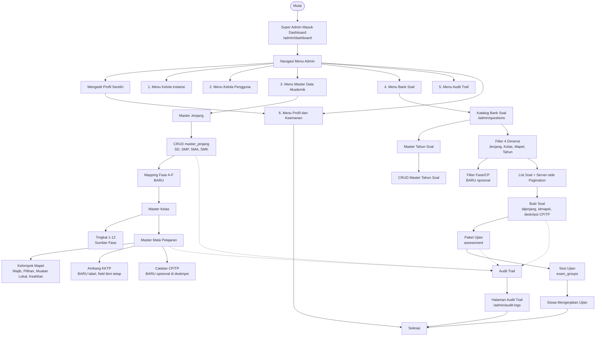
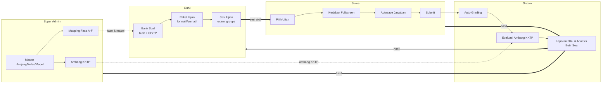

# Kurikulum Merdeka Integration

**Proyek:** Sistem CBT Ujian Online  
**Konteks:** Basis data `sertidemi`, Laravel 12 + React 19  
**Status Dokumen:** Analisis & Rencana Adaptasi  
**Basis Flow:** `dokumentasi/Overall_System_Flow_CBT_Updated.md` dan `dokumentasi/Flowchart_Documentation.md`

---

## 1. Ruang Lingkup

Dokumen ini menjelaskan:

1. Konsep Kurikulum Merdeka yang relevan dengan sistem CBT.
2. Pemetaan konsep kurikulum ke struktur data dan flow yang sudah berjalan.
3. Rencana adaptasi minimal tanpa merusak alur ujian eksisting.
4. Flow integrasi dalam format Mermaid.js.

Dokumen ini **tidak** mengubah alur bisnis utama: Super Admin menyiapkan master data, Guru menyusun bank soal dan paket ujian, Siswa mengerjakan ujian, lalu sistem melakukan auto-grading dan pelaporan.

---

## 2. Ringkasan Kurikulum Merdeka

### 2.1 Definisi

Kurikulum Merdeka adalah kurikulum dengan pembelajaran intrakurikuler yang beragam. Konten dioptimalkan agar peserta didik memiliki cukup waktu mendalami konsep dan menguatkan kompetensi. Guru memiliki keleluasaan memilih metode pembelajaran sesuai kebutuhan dan minat peserta didik.

### 2.2 Dasar Hukum

- **Permendikbudristek No. 12 Tahun 2024** tentang Kurikulum pada Pendidikan Anak Usia Dini, Jenjang Pendidikan Dasar, dan Jenjang Pendidikan Menengah.  
  Sumber: https://peraturan.go.id/id/permendikbudristek-no-12-tahun-2024
- **Keputusan Kepala BSKAP No. 032/H/KR/2024** tentang Capaian Pembelajaran pada Pendidikan Anak Usia Dini, Jenjang Pendidikan Dasar, dan Jenjang Pendidikan Menengah pada Kurikulum Merdeka.

### 2.3 Komponen Utama

| Komponen | Penjelasan |
| :--- | :--- |
| **Capaian Pembelajaran (CP)** | Kompetensi dan ruang lingkup materi yang harus dicapai peserta didik pada akhir fase. |
| **Tujuan Pembelajaran (TP)** | Penjabaran CP yang lebih spesifik dan terukur untuk satu atau beberapa pertemuan. |
| **Alur Tujuan Pembelajaran (ATP)** | Rangkaian TP yang disusun logis dan sistematis dalam satu fase. |
| **Asesmen Formatif** | Asesmen selama proses pembelajaran untuk memberi umpan balik dan perbaikan. |
| **Asesmen Sumatif** | Asesmen untuk mengukur ketercapaian tujuan pembelajaran pada akhir lingkup materi. |
| **KKTP** | Kriteria Ketercapaian Tujuan Pembelajaran; menggantikan konsep KKM pada Kurikulum 2013. |
| **P5** | Projek Penguatan Profil Pelajar Pancasila; bersifat kokurikuler, bukan ujian mata pelajaran. |

### 2.4 Fase Pendidikan

| Fase | Jenjang / Tingkat |
| :--- | :--- |
| **Fondasi** | PAUD |
| **A** | SD/MI Kelas I-II |
| **B** | SD/MI Kelas III-IV |
| **C** | SD/MI Kelas V-VI |
| **D** | SMP/MTs Kelas VII-IX |
| **E** | SMA/MA/SMK Kelas X |
| **F** | SMA/MA/SMK Kelas XI-XII |

Catatan:
- Sistem CBT saat ini memiliki jenjang **SD, SMP, SMA, SMK**. PAUD tidak termasuk ruang lingkup sistem.
- Untuk SMK program 4 tahun, struktur kelas dapat berbeda dan perlu mengikuti ketentuan khusus satuan pendidikan.
- Kurikulum Merdeka tidak menggunakan istilah **KKM**. Sistem tetap dapat memakai ambang angka sebagai penyederhanaan operasional CBT, tetapi label dan maknanya harus diarahkan menjadi **KKTP**.

---

## 3. Baseline Flow yang Sudah Ada

Berdasarkan `Overall_System_Flow_CBT_Updated.md`, flow Super Admin berjalan sebagai berikut:

1. Login -> Dashboard `/admin/dashboard`.
2. Navigasi menu: Kelola Instansi, Kelola Pengguna, Master Data Akademik, Bank Soal, Audit Trail, Profil & Keamanan.
3. Master Data Akademik: `master_jenjang` -> `master_kelas` -> `master_mata_pelajaran` (termasuk KKM).
4. Bank Soal: katalog soal dengan filter jenjang, kelas, mapel, dan tahun soal.
5. Audit Trail mencatat aksi create/edit.

Berdasarkan `Flowchart_Documentation.md`, siklus ujian lintas peran berjalan sebagai berikut:

1. **Super Admin** menyiapkan jenjang, kelas, mapel, dan standar nilai.
2. **Admin Sekolah** mengelola guru, siswa, dan rombel.
3. **Guru** membuat bank soal -> menyusun paket ujian (manual atau generate 50 soal) -> membuka sesi `exam_groups`.
4. **Siswa** memilih ujian -> mengerjakan fullscreen + autosave -> submit.
5. **Sistem** melakukan auto-grading -> hasil tampil ke siswa, guru, dan admin sekolah.

---

## 4. Pemetaan Kurikulum Merdeka ke Sistem

| Konsep Kurikulum Merdeka | Kondisi Sistem Saat Ini | Rencana Adaptasi |
| :--- | :--- | :--- |
| **Fase A-F** | `master_kelas.tingkat` menyimpan angka 1-12; `master_jenjang` menyimpan SD/SMP/SMA/SMK. | Turunkan fase dari `tingkat` di service/controller. Tidak perlu mengubah skema tabel untuk MVP. |
| **CP / TP / ATP** | Bank soal memiliki `idjenjang`, `idmapel`, `deskripsi`; belum ada field CP/TP khusus. | Gunakan `deskripsi` untuk catatan CP/TP pada MVP. Tambahkan field nullable hanya jika filtering CP/TP dibutuhkan. |
| **KKTP** | `master_mata_pelajaran.kkm` dan `assessment.kkm_score` berupa angka 0-100. | Pertahankan field untuk kompatibilitas. Ubah label UI menjadi "Ambang KKTP" dan dokumentasikan bahwa ini bukan KKM Kurikulum 2013. |
| **Mapel Wajib / Pilihan / Keahlian** | `master_mata_pelajaran.kelompok` berisi `Wajib`, `Peminatan`, `Muatan Lokal`, `Keahlian`. | Petakan `Peminatan` menjadi `Pilihan` pada tampilan/data baru. Data lama tetap dibaca sebagai alias. |
| **Asesmen Formatif / Sumatif** | `assessment` belum memiliki jenis asesmen eksplisit; tersedia kolom JSON `settings`. | Simpan `jenis_asesmen` di `settings` untuk MVP, atau tambahkan kolom nullable jika perlu pelaporan terpisah. |
| **P5** | Tidak ada modul projek. | Di luar ruang lingkup CBT. Jangan mencampur nilai P5 dengan nilai ujian mata pelajaran. |
| **Rapor deskriptif** | Laporan menampilkan skor angka, status tuntas/remedial, dan analisis butir soal. | Tambahkan catatan deskriptif berbasis capaian soal/TP bila diperlukan; bukan pengganti rapor resmi sekolah. |

### 4.1 Mapping Fase

Mapping berikut diusulkan di level aplikasi, bukan perubahan struktur database:

| `master_kelas.tingkat` | Fase |
| :---: | :---: |
| 1-2 | A |
| 3-4 | B |
| 5-6 | C |
| 7-9 | D |
| 10 | E |
| 11-12 | F |

Catatan teknis:
- `assessment` menyimpan `idjenjang`, `idkelas`, dan `idmapel`. Jika `idkelas` kosong, fase tidak dapat ditentukan secara pasti; tampilkan "Fase belum ditentukan" atau minta pengguna memilih kelas/tingkat.
- Generator 50 soal saat ini memfilter berdasarkan `idjenjang` dan `idmapel`, belum berdasarkan fase. Untuk menjaga kompatibilitas, fase dapat ditampilkan sebagai informasi dan filter tambahan, bukan syarat wajib.

---

## 5. Flow Integrasi (Mermaid.js)

### 5.1 Adaptasi Flow Super Admin

Flow berikut mempertahankan struktur menu pada `Overall_System_Flow_CBT_Updated.md`. Node bertanda **BARU** adalah penambahan konsep Kurikulum Merdeka; node lain tetap.

### 5.2 Flow End-to-End Asesmen

Flow berikut menunjukkan posisi Kurikulum Merdeka dalam siklus ujian yang sudah ada, dari master data sampai pelaporan.

---

## 6. Dampak Implementasi

### 6.1 Perubahan Minimal yang Disarankan

1. **Label UI**: ubah teks "KKM" menjadi "Ambang KKTP" pada halaman guru, admin, dan laporan.
2. **Mapping fase**: tambahkan helper/service untuk menurunkan fase dari `master_kelas.tingkat`.
3. **Filter bank soal**: tambahkan filter fase sebagai filter opsional; jangan wajibkan agar data lama tetap dapat dipakai.
4. **Jenis asesmen**: gunakan `assessment.settings` untuk menyimpan `jenis_asesmen` (`formatif`/`sumatif`) tanpa migrasi baru.
5. **Dokumentasi guru**: jelaskan bahwa `kkm_score` adalah ambang operasional CBT, bukan KKM resmi Kurikulum Merdeka.

### 6.2 Yang Tidak Diubah

- Alur login dan multi-tenancy.
- Alur bank soal -> paket ujian -> sesi -> pengerjaan -> submit.
- Mekanisme autosave, fullscreen, dan anti-cheat.
- Perhitungan skor objektif dan struktur tabel jawaban.
- P5 tidak dimasukkan ke dalam penilaian CBT.

---

## 7. Referensi

1. Permendikbudristek No. 12 Tahun 2024 tentang Kurikulum pada Pendidikan Anak Usia Dini, Jenjang Pendidikan Dasar, dan Jenjang Pendidikan Menengah.  
   https://peraturan.go.id/id/permendikbudristek-no-12-tahun-2024
2. Keputusan Kepala BSKAP No. 032/H/KR/2024 tentang Capaian Pembelajaran.
3. Halaman resmi Kurikulum Merdeka:  
   https://kurikulum.kemdikbud.go.id/kurikulum-merdeka/
4. Dokumentasi internal: `dokumentasi/Overall_System_Flow_CBT_Updated.md`
5. Dokumentasi internal: `dokumentasi/Flowchart_Documentation.md`
