# Dokumen Analisis & Desain: Overall System Flow CBT (Revisi Lengkap)

**Proyek:** Sistem CBT Ujian Online (*Computer-Based Testing*)  
**Konteks Integrasi:** Basis Data Multi-Tenant `sertidemi`  
**Status Dokumen:** Blueprint Resmi Analisis & Flow Sistem (Siap Dipindahkan ke Draw.io)  
**Lokasi File:** `dokumentasi/Overall_System_Flow_CBT.md`  

---

## 1. Review Flow yang Sudah Ada (Existing Flow Review)

Berdasarkan analisis menyeluruh terhadap arsitektur berjalan dan dokumen spesifikasi sebelumnya ([Flowchart_Documentation.md](file:///d:/MAGANG/exam/Sistem-Ujian-Online/dokumentasi/Flowchart_Documentation.md)), sistem saat ini telah memiliki fondasi alur bisnis yang solid pada siklus ujian. Berikut adalah tinjauan perannya:

### 1.1. Status Alur Peran Eksisting
1. **Super Admin:**
   - *Kondisi Eksisting:* Berfokus pada CRUD Master Data Global (Jenjang, Tingkat, Mata Pelajaran, KKM) dan Live Proctoring Nasional. Modul Instansi pada alur lama hanya mencatat nama instansi sederhana (`kategori_user_bo.nama_kategori`) dan pendaftaran akun pengguna staf.
   - *Kekurangan:* Belum memiliki pencatatan profil legalitas instansi (NPSN, Akreditasi, Legalitas), informasi kontak/PIC, alamat presisi (geolokasi koordinat), konfigurasi lisensi/masa aktif, serta filter multikriteria pada tabel instansi.
2. **Admin Instansi / Admin Sekolah (Role yang Sama):**
   - *Kondisi Eksisting:* Terisolasi berdasarkan `user.idkategori`. Bertugas mengelola akun guru lokal, pendaftaran siswa, pembagian rombel kelas (`master_kelas`), penetapan Wali/Guru Kelas, dan pemantauan Laporan Keseluruhan Nilai.
   - *Kekurangan:* Dashboard Admin Instansi belum memiliki kartu metrik operasional lengkap (9 kartu indikator utama) serta belum memvisualisasikan tren aktivitas ujian dan grafik login pengguna (Guru & Siswa).
3. **Guru / Tenaga Pendidik:**
   - *Kondisi Eksisting (Sudah Benar & Dipertahankan):*
     - Bank Soal murni sebagai repositori (input satuan / impor CSV/Word, **tanpa fitur generate**).
     - Paket Ujian memiliki **fitur eksklusif Generate 50 Soal Acak** atau pemilihan manual butir soal.
     - Guru memilih paket soal -> Mengatur jadwal & kelas di gelombang sesi ujian (`exam_groups`) -> Memulai sesi ujian.
     - Menerima laporan nilai, daya beda, dan ketuntasan KKM 75.
4. **Siswa / Peserta Ujian:**
   - *Kondisi Eksisting (Sudah Benar & Dipertahankan):*
     - Siswa memilih paket soal aktif di dashboard -> Klik "Mulai Sesi Ujian" -> Validasi rentang waktu sesi -> Masuk ruang ujian fullscreen + anti-cheat (toleransi 5x Alt+Tab).
     - Autosave pilihan jawaban instan ke database per klik -> Submit ujian -> Nilai instan skala 100 dan lembar pembahasan.
5. **Backend Engine:**
   - Dual-entity authentication (`user_bo` & `user`), single-session gatekeeper (`active_session_token`), dan synchronous auto-grading engine.

---

## 2. Pemetaan & Posisi Penambahan Flow Baru (Tanpa Mengubah Alur Lama)

Penambahan fitur baru diintegrasikan secara presisi pada 2 titik modul utama tanpa mengubah logika ujian yang sudah berjalan:

```
[PORTAL UTAMA]
       │
       ├───► [SUPER ADMIN]
       │         │
       │         ├───► Master Data Global (Jenjang, Mapel, KKM) [LAMA - TETAP]
       │         ├───► Live Proctoring Nasional [LAMA - TETAP]
       │         │
       │         └───► [TITIK REVISI 1, 2, 4]: MODUL KELOLA INSTANSI
       │                   ├─── [Sub-Flow 4]: List Instansi (Tabel Kaya Kolom & Multi-Filter)
       │                   ├─── [Sub-Flow 1]: Tambah/Edit Instansi (Wizard 4 Section: Info Dasar, Kontak, Alamat, Pengaturan)
       │                   └─── [Sub-Flow 2]: Detail Instansi (4 Tab: Profil, Statistik, Penggunaan, Aktivitas)
       │
       └───► [ADMIN INSTANSI / SEKOLAH] (Role Sama)
                 │
                 ├───► [TITIK REVISI 3]: DASHBOARD ADMIN INSTANSI
                 │         ├─── 9 Card Statistik Utama
                 │         └─── 3 Grafik Analitik (Aktivitas Ujian, Login Guru, Login Siswa)
                 │
                 ├───► Kelola Guru & Rombel Kelas [LAMA - TETAP]
                 ├───► Kelola Siswa & Penempatan Kelas [LAMA - TETAP]
                 └───► Laporan Keseluruhan Sekolah [LAMA - TETAP]
```

### Posisi Integrasi:
1. **Titik Revisi 1 & 4 (List & Kelola Instansi Super Admin):** Menggantikan antarmuka form modal sederhana di `/admin/instansi` menjadi halaman manajemen multi-tenant modern dengan tabel data kaya informasi dan form berstruktur 4 tab/section.
2. **Titik Revisi 2 (Detail Instansi Super Admin):** Menjadi halaman eksplorasi mendalam (`/admin/instansi/:id`) yang dibuka saat Super Admin menekan aksi "Detail" pada tabel instansi.
3. **Titik Revisi 3 (Dashboard Admin Instansi):** Menyempurnakan tampilan awal `/admin/dashboard` bagi pengguna dengan peran Admin Instansi/Sekolah agar menyajikan 9 kartu ringkasan eksekutif serta 3 grafik interaktif sebelum admin masuk ke menu teknis.

---

## 3. Rekomendasi Teknis & Mitigasi Alur yang Berpotensi Membingungkan

Sebelum menuangkan ke dalam bentuk diagram Draw.io, berikut adalah rekomendasi kritis agar flow sistem tidak menimbulkan ambiguitas operasional maupun kendala teknis:

### 3.1. Penegakan Lisensi Kedaluwarsa (*License Expiration Enforcement*)
- **Potensi Masalah:** Apa yang terjadi jika `tanggal_expired` terlewati atau `status_instansi == 'Nonaktif'`? Apakah admin, guru, dan siswa langsung diblokir total?
- **Rekomendasi Flow:**
  - Terapkan **License Gateway Middleware**.
  - Jika `status_instansi == 'Nonaktif'` atau `today > tanggal_expired`:
    - **Siswa & Guru:** Dialihkan ke halaman blokir informatif: *"Masa aktif lisensi instansi Anda telah berakhir. Silakan hubungi Administrator Sekolah."* (Mencegah siswa memulai ujian saat tagihan/lisensi mati).
    - **Admin Instansi:** Masih diizinkan login dalam mode *Read-Only* dengan banner peringatan masa tenggang (*Grace Period*), untuk melihat laporan arsip dan mengajukan perpanjangan lisensi ke Super Admin.

### 3.2. Penanganan Metrik "Jumlah Soal Essay" pada Tab Penggunaan
- **Potensi Masalah:** Sistem CBT saat ini mengandalkan auto-grading pada soal Pilihan Ganda (`assessment_soal_pilgan`). Adanya indikator "Jumlah Soal Essay" pada tab Penggunaan Instansi menuntut kejelasan penanganan alur nilai.
- **Rekomendasi Flow:**
  - Bank Soal perlu membedakan flag `tipe_soal` (`Pilihan Ganda` vs `Essay`).
  - Untuk soal Essay, alur pengerjaan siswa tetap berjalan, namun penskoran akhir tidak langsung final (`status_penilaian = 'Perlu Diperiksa Guru'`). Nilai baru keluar setelah guru melakukan koreksi manual (*Manual Grading Flow*).

### 3.3. Pelacakan Metrik Storage Instansi
- **Rekomendasi Flow:**
  - Metrik "Storage" dihitung secara agregat dari:
    $$\text{Total Storage} = \text{File Logo} + \text{Gambar Soal (Bank Soal)} + \text{Dokumen Impor (.docx/.csv)} + \text{Foto Profil Pengguna}$$
  - Tampilkan batas kapasitas lisensi (misal: `1.2 GB / 5.0 GB` dengan indikator *progress bar* persentase).

### 3.4. Hak Akses Detail Instansi untuk Admin Instansi (*Self-Profile*)
- **Rekomendasi Flow:**
  - Menu "Detail Instansi" di sisi Super Admin adalah alat audit dan supervisi seluruh sekolah.
  - Untuk Admin Instansi, alur ini dapat diakses sebagai menu **"Profil Instansi Saya"** (hanya data instansi miliknya sendiri), sehingga Admin Instansi mengetahui profil kontak, batas kuota siswa, sisa hari aktif lisensi, dan kapasitas storage sekolahnya.

### 3.5. Standarisasi Data Wilayah (Provinsi s/d Titik Peta)
- **Rekomendasi Flow:**
  - Input Alamat menggunakan *cascading dropdown* (Provinsi -> Kota/Kabupaten -> Kecamatan -> Kelurahan) yang terintegrasi dengan kode wilayah standar, sehingga filter "Kota" pada List Instansi memiliki nilai baku (*consistent enum/lookup*).
  - Titik Lokasi Google Maps menyimpan nilai koordinat lintang dan bujur (`latitude`, `longitude`) yang dapat dipilih melalui pin map interaktif.

---

## 4. Struktur Flow Lengkap untuk Draw.io (Swimlane & Notasi Standar)

Berikut adalah struktur terpadu yang dirancang khusus untuk kemudahan pemindahan ke Draw.io, menggunakan aturan penamaan node, swimlane peran, dan simbol standar diagram alir.

### 4.1. Panduan Visual Notasi Draw.io
- **Terminal (Oval / Rounded Rectangle):** Titik awal (`Start`) dan titik akhir (`End`) suatu proses.
- **Process (Persegi Panjang):** Tindakan, kalkulasi, pemrosesan formulir, atau aksi sistem.
- **Decision (Belah Ketupat / Diamond):** Percabangan logika atau validasi kondisi (Wajib ada label cabang `[Ya]` / `[Tidak]`).
- **Input / Output (Jajar Genjang):** Entri data form pengguna atau keluaran tampilan dokumen.
- **Database (Tabung / Silinder):** Penyimpanan atau pembacaan tabel basis data MySQL.

---

### 4.2. Master Flowchart Mermaid: Integrasi Keseluruhan (Cross-Functional Swimlane)

```mermaid
flowchart TD
    %% ========================================================
    %% SWIMLANE 1: SUPER ADMIN
    %% ========================================================
    subgraph SA["SWIMLANE 1: SUPER ADMIN (Global Manager)"]
        SA_START([Mulai: Super Admin Login]) --> SA_DASH[Dashboard Global /admin/dashboard]
        SA_DASH --> SA_MENU{Pilih Menu Operasi}
        
        SA_MENU -->|Master Data| SA_MST[Kelola Master Jenjang, Mapel, KKM]
        SA_MENU -->|Supervisi Ujian| SA_MON[Live Proctoring Multi-Sekolah]
        SA_MENU -->|Manajemen Sekolah| SA_INST_LIST[Buka Menu List Instansi /admin/instansi]

        %% List Instansi & Filter
        SA_INST_LIST --> SA_FILTER[/Gunakan Filter: Nama, Jenjang, Kota, Status, Masa Aktif/]
        SA_FILTER --> SA_TABLE[Tampil Tabel Instansi: Logo, Nama, NPSN, Jenjang, Kota, Guru, Siswa, Bank Soal, Status, Expired, Aksi]
        
        %% Aksi dari List
        SA_TABLE --> SA_ACT{Pilih Aksi Instansi}
        
        %% 1. Tambah / Edit Instansi (Wizard Form)
        SA_ACT -->|Tambah / Edit Instansi| SA_FORM_OPEN[Buka Form Kelola Instansi]
        SA_FORM_OPEN --> SA_SEC1[Section 1: Info Dasar - Logo, Nama, NPSN, Jenis, Status, Akreditasi, Thn Berdiri]
        SA_SEC1 --> SA_SEC2[Section 2: Kontak - Nama PIC, Jabatan, HP, WhatsApp, Email, Website]
        SA_SEC2 --> SA_SEC3[Section 3: Alamat - Provinsi, Kota, Kec, Kel, Kodepos, Alamat Lengkap, Koordinat Maps]
        SA_SEC3 --> SA_SEC4[Section 4: Pengaturan - Timezone, Bahasa, Status, Paket Lisensi, Tgl Aktif, Tgl Expired]
        SA_SEC4 --> SA_SUBMIT_INST[Klik Simpan Instansi]

        %% 2. Detail Instansi
        SA_ACT -->|Klik Detail Instansi| SA_DETAIL[Buka Halaman Detail Instansi]
        SA_DETAIL --> SA_TAB_DET{Pilih Tab Informasi}
        SA_TAB_DET -->|Profil| SA_DT_PROF[Tab Profil: Identitas Lengkap, Kontak PIC, Legalitas, & Peta Lokasi]
        SA_TAB_DET -->|Statistik| SA_DT_STAT[Tab Statistik: Guru, Siswa, Kelas, Mapel, Bank Soal, Paket, Jadwal, Ujian Aktif/Selesai]
        SA_TAB_DET -->|Penggunaan| SA_DT_USAGE[Tab Penggunaan: Total Guru/Siswa/Admin, Storage MB/GB, Bank Soal, Soal PG & Essay]
        SA_TAB_DET -->|Aktivitas| SA_DT_ACT[Tab Aktivitas: Log Import Soal, Generate Paket, Tambah Guru/Siswa, Login Terakhir]

        %% 3. Terbitkan Akun Admin
        SA_ACT -->|Akun Sekolah| SA_ADMIN_ACC[Buat / Reset Akun Admin Instansi: user_bo role: admin]
    end

    %% ========================================================
    %% SWIMLANE 2: ADMIN INSTANSI / ADMIN SEKOLAH (Role Sama)
    %% ========================================================
    subgraph AI["SWIMLANE 2: ADMIN INSTANSI / SEKOLAH (Tenant Operator)"]
        AI_START([Mulai: Admin Instansi Login]) --> AI_AUTH_CHK{Cek Status & Masa Aktif Lisensi}
        AI_AUTH_CHK -->|Expired / Nonaktif| AI_EXPIRED_WARN[Tampilkan Layar Peringatan Lisensi Habis / Mode Read-Only]
        AI_AUTH_CHK -->|Aktif & Valid| AI_DASH[Masuk Dashboard Admin Instansi]

        %% Dashboard Cards & Charts
        AI_DASH --> AI_DASH_CARDS[Tampil 9 Card Statistik: Total Guru, Siswa, Kelas, Mapel, Bank Soal, Paket Soal, Ujian Aktif, Ujian Hari Ini, Ujian Selesai]
        AI_DASH --> AI_DASH_CHARTS[Tampil 3 Grafik Analitik: 1. Aktivitas Ujian, 2. Keaktifan Guru, 3. Kehadiran Siswa]
        
        AI_DASH --> AI_OPERASI{Pilih Menu Operasional}
        AI_OPERASI -->|Kelola Guru| AI_GURU[Registrasi Akun Guru Sekolah]
        AI_OPERASI -->|Kelola Kelas| AI_KELAS[Atur Rombel Kelas & Tetapkan Guru/Wali Kelas]
        AI_OPERASI -->|Kelola Siswa| AI_SISWA[Daftarkan Siswa & Alokasi ke Kelas]
        AI_OPERASI -->|Laporan| AI_LAP[Laporan Keseluruhan: Siapa Guru Kelas & Nilai per Paket Ujian]
    end

    %% ========================================================
    %% SWIMLANE 3: GURU
    %% ========================================================
    subgraph G["SWIMLANE 3: GURU / PENGAJAR"]
        G_START([Mulai: Guru Login]) --> G_DASH[Dashboard Guru]
        G_DASH --> G_BS[Bank Soal: Input Manual / Import CSV-Word - Tanpa Fitur Generate]
        G_DASH --> G_PK[Paket Soal: Buat Paket]
        G_PK --> G_GEN_DEC{Pilih Cara Pembuatan Paket}
        G_GEN_DEC -->|Fitur Generate Soal| G_GEN_ACT[Generate 50 Soal Acak CUMA di Paket Soal]
        G_GEN_DEC -->|Manual| G_MAN_ACT[Pilih Butir Soal Tertentu dari Bank Soal]
        G_GEN_ACT --> G_PK_READY[Paket Soal Terbentuk]
        G_MAN_ACT --> G_PK_READY
        G_PK_READY --> G_START_SES[Mulai Sesi Ujian: Atur Gelombang, Jadwal Mulai-Selesai, & Kelas Peserta]
        G_START_SES --> G_SES_PUB[Sesi Ujian Aktif Diterbitkan]
    end

    %% ========================================================
    %% SWIMLANE 4: SISWA
    %% ========================================================
    subgraph S["SWIMLANE 4: SISWA / PESERTA"]
        S_START([Mulai: Siswa Login]) --> S_DASH[Dashboard Siswa: Kartu Ujian Terjadwal]
        S_DASH --> S_CHOOSE[Siswa Memilih Paket Soal]
        S_CHOOSE --> S_START_BTN{Klik 'Mulai Sesi Ujian'}
        S_START_BTN --> S_TIME_VAL{Validasi Jadwal Sesi}
        S_TIME_VAL -->|Belum Mulai / Lewat| S_WAIT[Akses Ditolak: Di Luar Jadwal Sesi]
        S_TIME_VAL -->|Aktif| S_RUN[Ruang Ujian Fullscreen + Anti-Cheat 5x Alt+Tab]
        S_RUN --> S_AUTOSAVE[Autosave Jawaban per Klik]
        S_RUN --> S_SUBMIT[Submit Ujian Selesai]
        S_SUBMIT --> S_RESULT[Nilai Instan Skala 100 & Pembahasan KaTeX]
    end

    %% ========================================================
    %% SWIMLANE 5: BACKEND ENGINE & DATABASE
    %% ========================================================
    subgraph DB["SWIMLANE 5: BACKEND ENGINE & DATABASE (sertidemi)"]
        SYS_SAVE_INST[(Tabel kategori_user_bo, instansi_detail, lisensi)]
        SYS_LOG[(Tabel audit_log_aktivitas)]
        SYS_CBT[(Tabel assessment, exam_groups, jawaban_pilgan)]
        SYS_GRADER[Synchronous Auto-Grading Engine]
    end

    %% RELASI CROSS-FUNCTIONAL
    SA_SUBMIT_INST --> SYS_SAVE_INST
    SA_ADMIN_ACC -.->|Kredensial Akses Diberikan| AI_START
    AI_GURU -.->|Terbitkan Akun Guru| G_START
    AI_SISWA -.->|Terbitkan Akun Siswa| S_START
    G_SES_PUB ==>|Terbitkan Sesi Ujian Aktif| S_DASH
    S_AUTOSAVE --> SYS_CBT
    S_SUBMIT --> SYS_GRADER
    SYS_GRADER --> SYS_CBT
    SYS_CBT ==>|Umpan Balik Skor Instan| S_RESULT
    SYS_CBT ==>|Laporan Mutu Akademik| AI_LAP
    SYS_LOG --> SA_DT_ACT
```



---

## 5. Rincian Modul Step-by-Step (Spesifikasi Eksekusi Draw.io)

Gunakan daftar blok terperinci berikut saat menyusun objek diagram satu per satu pada kanvas Draw.io:

```
========================================================================================
MODUL 1: LIST INSTANSI & FILTERING (SUPER ADMIN)
========================================================================================
[ID: SA-LI-01] Type: Terminal | Label: Masuk Halaman List Instansi (/admin/instansi)
       │
[ID: SA-LI-02] Type: Process  | Label: Sistem mengambil daftar instansi dengan query agregasi data
       │
[ID: SA-LI-03] Type: Input/Output | Label: Terapkan Filter Pencarian Data:
       │                                  1. Nama Instansi (Input Pencarian Teks)
       │                                  2. Jenjang Pendidikan (Dropdown: SD, SMP, SMA, SMK)
       │                                  3. Kota / Kabupaten (Dropdown Lokasi)
       │                                  4. Status Instansi (Dropdown: Aktif / Nonaktif)
       │                                  5. Masa Aktif (Dropdown: Aktif, Segera Expired <30 Hari, Expired)
       │
[ID: SA-LI-04] Type: Database | Label: Query kategori_user_bo JOIN relasi agregasi guru, siswa, soal
       │
[ID: SA-LI-05] Type: Input/Output | Label: Tampilkan Tabel Data Instansi dengan Kolom:
       │                                  - Logo Instansi (Thumbnail Avatar)
       │                                  - Nama Instansi
       │                                  - NPSN (Nomor Pokok Sekolah Nasional)
       │                                  - Jenjang (SD / SMP / SMA / SMK)
       │                                  - Kota
       │                                  - Total Guru Terdaftar
       │                                  - Total Siswa Terdaftar
       │                                  - Total Bank Soal
       │                                  - Status (Badge Hijau: Aktif / Badge Abu: Nonaktif)
       │                                  - Masa Expired (Tanggal & Badge Sisa Hari)
       │                                  - Aksi (Tombol: Detail, Edit, Kelola Admin, Nonaktifkan)
       │
[ID: SA-LI-06] Type: Decision | Label: Pilih Aksi Baris Instansi?
       ├──► [Opsi A: Klik 'Tambah Instansi' atau 'Edit'] ─────────► Lanjut ke [MODUL 2: FORM WIZARD]
       ├──► [Opsi B: Klik 'Detail Instansi'] ─────────────────────► Lanjut ke [MODUL 3: DETAIL INSTANSI]
       └──► [Opsi C: Klik 'Kelola Admin'] ────────────────────────► Form Input Akun Admin Sekolah

========================================================================================
MODUL 2: FORM KELOLA INSTANSI (TAMBAH / EDIT WIZARD 4 SECTION)
========================================================================================
[ID: SA-FO-01] Type: Terminal | Label: Buka Form Modal/Page Kelola Instansi
       │
[ID: SA-FO-02] Type: Process  | Label: Tampilkan Navigasi 4 Section / Tab Form
       │
       ├──► [SECTION 1: INFORMASI DASAR]
       │    - Unggah Berkas Logo Instansi (Format JPG/PNG, Max 2MB)
       │    - Input Nama Instansi (Wajib)
       │    - Input NPSN (8 Digit Angka Standar Kemendikbud)
       │    - Pilih Jenis Instansi (Sekolah / Madrasah / PKBM / Bimbingan Belajar / Kampus)
       │    - Pilih Status Instansi (Negeri / Swasta)
       │    - Pilih Akreditasi (A / B / C / Belum Terakreditasi)
       │    - Input Tahun Berdiri (Format YYYY)
       │
       ├──► [SECTION 2: KONTAK & PENANGGUNG JAWAB]
       │    - Input Nama PIC (Person in Charge)
       │    - Input Jabatan PIC (Kepala Sekolah / Wakakur / Admin IT)
       │    - Input Nomor HP PIC
       │    - Input Nomor WhatsApp PIC (Untuk notifikasi sistem)
       │    - Input Alamat Email Resmi Instansi
       │    - Input URL Website Instansi (https://...)
       │
       ├──► [SECTION 3: ALAMAT & GEOLOKASI]
       │    - Pilih Provinsi (Dropdown Cascading)
       │    - Pilih Kota / Kabupaten (Dropdown Terfilter Provinsi)
       │    - Pilih Kecamatan (Dropdown Terfilter Kota)
       │    - Pilih Kelurahan / Desa
       │    - Input Kode Pos (5 Digit)
       │    - Input Alamat Lengkap (Nama Jalan, RT/RW, No. Gedung)
       │    - Titik Lokasi Peta: Picker Google Maps / Input Koordinat (Latitude & Longitude)
       │
       └──► [SECTION 4: PENGATURAN & LISENSI SISTEM]
            - Pilih Timezone (WIB: Asia/Jakarta | WITA: Asia/Makassar | WIT: Asia/Jayapura)
            - Pilih Bahasa Antarmuka (Bahasa Indonesia / English)
            - Pilih Status Instansi (Aktif / Nonaktif / Suspend)
            - Pilih Paket Lisensi (Trial 14 Hari / Basic / Pro / Enterprise Multi-Kampus)
            - Tentukan Tanggal Mulai Aktif (Datepicker)
            - Tentukan Tanggal Expired Lisensi (Datepicker)
       │
[ID: SA-FO-03] Type: Decision | Label: Validasi Kelengkapan Field Wajib?
       ├──► [Tidak Valid] ──► Tampilkan pesan error validasi kolom merah ──► Kembali ke Form
       └──► [Valid]       ──► Kirim payload multipart/form-data ke backend
                                    │
[ID: SA-FO-04] Type: Database | Label: Simpan data ke kategori_user_bo & instansi_metadata
       │
[ID: SA-FO-05] Type: Terminal | Label: Selesai: Tampilkan Toast Notifikasi Sukses & Refresh Tabel

========================================================================================
MODUL 3: DETAIL INSTANSI (360° TENANT VIEW - SUPER ADMIN)
========================================================================================
[ID: SA-DE-01] Type: Terminal | Label: Masuk Halaman Detail Instansi (/admin/instansi/:id)
       │
[ID: SA-DE-02] Type: Process  | Label: Muat Data Agregasi Instansi Terpilih
       │
[ID: SA-DE-03] Type: Process  | Label: Navigasi 4 Tab Informasi Utama:
       │
       ├──► [TAB 1: PROFIL INSTANSI]
       │    - Header: Banner Sekolah, Logo, Nama Resmi, & Status Akreditasi
       │    - Ringkasan Legalitas: NPSN, Jenis, Status (Negeri/Swasta), Tahun Berdiri
       │    - Informasi Kontak & PIC: Nama PIC, Jabatan, HP, WhatsApp, Email, Website
       │    - Alamat & Integrasi Peta: Alamat tekstual lengkap & widget peta interaktif
       │    - Informasi Lisensi: Paket lisensi aktif, sisa durasi hari, tanggal expired
       │
       ├──► [TAB 2: STATISTIK INSTANSI (METRIK OPERASIONAL)]
       │    - Card 1: Total Guru Terdaftar
       │    - Card 2: Total Siswa Terdaftar
       │    - Card 3: Total Rombel Kelas
       │    - Card 4: Total Mata Pelajaran Aktif
       │    - Card 5: Total Bank Soal Terkumpul
       │    - Card 6: Total Paket Soal Ujian (TryOut/Asesmen)
       │    - Card 7: Total Jadwal Sesi Ujian (exam_groups)
       │    - Card 8: Total Ujian Sedang Berlangsung (Active Attempts)
       │    - Card 9: Total Ujian Telah Selesai (Submitted Attempts)
       │
       ├──► [TAB 3: PENGGUNAAN INSTANSI (KONSUMSI SUMBER DAYA)]
       │    - Kuota Pengguna: Total Guru Aktif, Total Siswa Aktif, Total Admin Instansi
       │    - Kuota & Pemakaian Storage: Kapasitas Penyimpanan Terpakai (MB/GB) vs Kuota Lisensi
       │    - Repositori Konten Soal:
       │      * Jumlah Bank Soal
       │      * Jumlah Soal Pilihan Ganda (Opsi A-E)
       │      * Jumlah Soal Essay (Uraian)
       │    - Bar Utilisasi: Persentase penggunaan kuota siswa dan kuota penyimpanan
       │
       └──► [TAB 4: AKTIVITAS INSTANSI (AUDIT TRAIL LOG)]
            - Feed riwayat aktivitas berurutan waktu (Timeline):
              * Log Import Soal (Waktu, Nama Guru, Jumlah Butir Soal, Format CSV/Word)
              * Log Generate Paket (Waktu, Pembuat, Nama Paket, Jumlah Soal)
              * Log Tambah Guru (Waktu, Nama Guru, NIP/Username)
              * Log Tambah Siswa (Waktu, Nama Siswa, NISN, Rombel Kelas)
              * Log Login Terakhir (Riwayat waktu masuk staf admin & guru instansi)
              * Log Perubahan Status / Konfigurasi Instansi

========================================================================================
MODUL 4: DASHBOARD ADMIN INSTANSI (ADMIN SEKOLAH - ROLE SAMA)
========================================================================================
[ID: AI-DB-01] Type: Terminal | Label: Admin Instansi Berhasil Login (WHERE idkategori = user.idkategori)
       │
[ID: AI-DB-02] Type: Decision | Label: Apakah Masa Lisensi Sekolah Masih Berlaku?
       ├──► [Expired / Nonaktif] ──► Tampilkan Mode Read-Only & Banner Peringatan Lisensi
       └──► [Aktif]               ──► Masuk ke Tampilan Penuh Dashboard (/admin/dashboard)
                                             │
[ID: AI-DB-03] Type: Process  | Label: Render Grid 9 Kartu Metrik Statistik Minimal:
       │                              1. Card 'Total Guru' (Jumlah guru pengajar instansi)
       │                              2. Card 'Total Siswa' (Jumlah siswa aktif instansi)
       │                              3. Card 'Total Kelas' (Jumlah rombel belajar)
       │                              4. Card 'Total Mata Pelajaran' (Jumlah mapel aktif)
       │                              5. Card 'Total Bank Soal' (Total butir soal di repositori)
       │                              6. Card 'Total Paket Soal' (Paket ujian terdaftar di instansi)
       │                              7. Card 'Ujian Aktif' (Sesi ujian sedang berjalan detik ini)
       │                              8. Card 'Ujian Hari Ini' (Agenda sesi ujian terjadwal hari ini)
       │                              9. Card 'Ujian Selesai' (Riwayat ujian yang telah tuntas)
       │
[ID: AI-DB-04] Type: Process  | Label: Render 3 Grafik Analitik & Tren Interaktif:
       │                              1. Grafik Aktivitas Ujian (Tren jumlah sesi & siswa per hari/minggu)
       │                              2. Grafik Login Guru (Tingkat frekuensi kehadiran guru pendidik)
       │                              3. Grafik Login Siswa (Tingkat keaktifan kehadiran peserta ujian)
       │
[ID: AI-DB-05] Type: Process  | Label: Panel Pantauan Cepat (Quick Access):
       │                              - Tombol Pintas: Input Siswa Baru, Buat Kelas, Pantau Nilai
       │                              - Widget Monitoring Sesi Ujian Real-Time & Deteksi Pelanggaran Alt+Tab
       │
[ID: AI-DB-06] Type: Terminal | Label: Admin Instansi Siap Menjalankan Operasional Sekolah
```

---

## 6. Format Properti & Kode Warna untuk Draw.io

Untuk menghasilkan diagram yang rapi, profesional, dan mudah dibaca oleh tim pengembang serta pemangku kepentingan, gunakan skema kode warna (Hex Color) berikut di Draw.io:

| Swimlane / Elemen | Peran / Fungsi | Fill Color | Stroke Color | Font Color |
| :--- | :--- | :--- | :--- | :--- |
| **Swimlane 1** | Super Admin | `#EEF2FF` (Indigo Light) | `#6366F1` (Indigo 500) | `#1E1B4B` (Indigo 950) |
| **Swimlane 2** | Admin Instansi / Sekolah | `#F5F3FF` (Purple Light) | `#8B5CF6` (Purple 500) | `#2E1065` (Purple 950) |
| **Swimlane 3** | Guru / Pengajar | `#ECFDF5` (Emerald Light) | `#10B981` (Emerald 500) | `#064E3B` (Emerald 950) |
| **Swimlane 4** | Siswa / Peserta | `#ECFEFF` (Cyan Light) | `#06B6D4` (Cyan 500) | `#164E63` (Cyan 950) |
| **Swimlane 5** | Backend & Database | `#F8FAFC` (Slate Light) | `#64748B` (Slate 500) | `#0F172A` (Slate 900) |
| **Decision Node** | Validasi / Percabangan | `#FEF3C7` (Amber Light) | `#F59E0B` (Amber 500) | `#78350F` (Amber 900) |
| **Warning / Block** | Akses Ditolak / Expired | `#FEE2E2` (Rose Light) | `#EF4444` (Rose 500) | `#7F1D1D` (Rose 900) |

---

## 7. Kesimpulan & Rekomendasi Langkah Selanjutnya

1. **Integritas Alur:** Seluruh flow eksisting pada siklus pengerjaan ujian (Guru membuat bank soal, generate soal hanya di paket, siswa mengerjakan fullscreen dengan anti-cheat 5x, dan evaluasi hasil instan) tetap 100% terjaga dan tidak berubah.
2. **Kesesuaian Kebutuhan:** Keempat poin revisi (Form Kelola Instansi 4 section, Detail Instansi 4 tab, Dashboard Admin Instansi 9 kartu + 3 grafik, dan List Instansi multi-filter) telah ditempatkan secara harmonis pada modul Super Admin dan Admin Instansi.
3. **Kesiapan Pemodelan:** Diagram Mermaid dan spesifikasi step-by-step di atas siap di-impor langsung ke Draw.io (*Arrange -> Insert -> Advanced -> Mermaid* atau digambar secara modular menggunakan nomor ID node).
