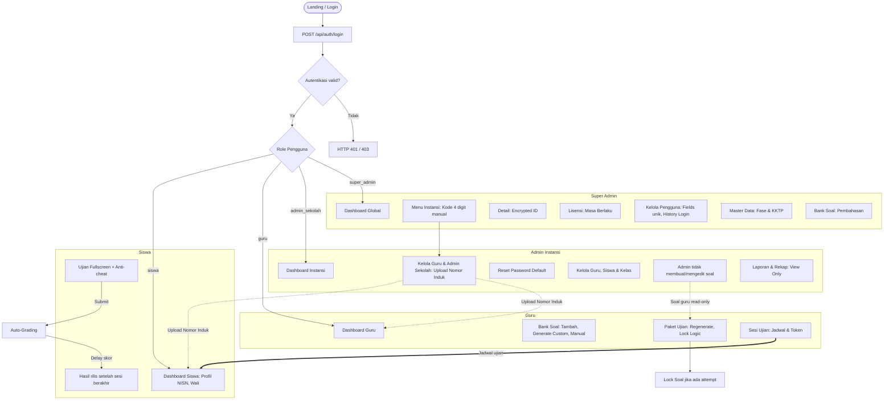

# Dokumen Analisis: Overall System Flow CBT (All Users)

**Proyek:** Sistem CBT Ujian Online  
**Cakupan:** Alur end-to-end seluruh aktor (Super Admin, Admin Instansi, Guru, Siswa, dan Backend/DB)  
**Status:** Blueprint Analisis (Pembaruan 2026/10/22)  
**Tujuan:** Visualisasi operasional sistem terpadu, termasuk adaptasi Kurikulum Merdeka dan persyaratan baru.

---

## 1. Flowchart Lintas Peran (Mermaid.js)

Versi lengkap dan siap render: `dokumentasi/Overall_System_Flow_CBT_All_Users.mmd`.  
Diagram di bawah adalah ringkasan untuk dokumen.

---

## 2. Detail Operasional & Aturan Baru

### 2.1 Login & Profil
- **Super Admin**: `username`.
- **Admin Instansi**: `username` (dibuat Super Admin).
- **Guru & Siswa**: `nomor induk` (diupload Admin Instansi). Email hanya untuk profil.
- **Reset Password**: Mandiri di profil (tahu pass lama) atau Admin Instansi (reset ke password default instansi).
- **Profil Guru/Siswa**: Wajib `NUPTK`/`NISN` sebagai nomor induk unik, kelas, jenis kelamin, telp, alamat.

### 2.2 Super Admin (Menu Instansi)
- **Kode Instansi**: 4-digit unik, diinput manual, *immutable*.
- **Detail**: Menggunakan *Encrypted ID* di URL untuk keamanan.
- **Lisensi**: Menampilkan status aktif/expired dan masa berlaku instansi.

### 2.3 Admin Instansi (Tenant Operator)
- **Manajemen**: Bisa membuat Guru/Siswa via upload/tambah dan kelola kelas/rombel.
- **Soal**: Tidak boleh membuat/mengedit/menghapus soal. Soal buatan Guru bersifat read-only bagi Admin.
- **Laporan**: Melihat laporan nilai dan rekap kelas (view-only).
- **Password**: Bisa set/reset password default untuk guru/siswa.

### 2.4 Guru
- **Soal**: Generate soal jumlah custom, bisa pilih manual, tambah soal sendiri, dan *regenerate* paket.
- **Locking**: Soal terkunci jika ada siswa mulai attempt.

### 2.5 Siswa
- **Detail Ujian**: Sebelum ujian mulai atau setelah sesi berakhir tanpa attempt, siswa hanya melihat detail ujian: jumlah soal, guru, mapel, jadwal, dan kelas. Soal tidak ditampilkan.
- **Hasil**: Skor dan detail soal/pembahasan hanya muncul setelah sesi berakhir dan tidak bisa dikerjakan lagi, dan hanya untuk siswa yang sudah mengerjakan.

---

## 3. Matriks Traceability (Flow vs Database/Controller)

| Flow Node | Tabel Utama | Controller/Model |
| :--- | :--- | :--- |
| **Login** | `user_bo`, `user` | `LoginController` |
| **Profil & Pass** | `user_bo`, `user` | `ProfileController` |
| **Instansi (4 digit ID)** | `kategori_user_bo` | `InstansiController` |
| **Bank Soal** | `assessment_soal_pilgan` | `TeacherQuestionBankController` |
| **Paket Ujian** | `assessment` | `TeacherExamController` |
| **Sesi Ujian** | `exam_groups` | `ExamGroupController` |
| **Submit & Grade** | `assessment_jawaban_pilgan` | `ExamAttemptController`, `ResultController` |

---

## 4. Panduan Start Code Lanjutan

1.  **Database Migration**:
    - Tambah kolom `kode_instansi` (unique, 4 digit) di `kategori_user_bo`.
    - Tambah `nomor_induk` (unique, index) di `user_bo` (untuk guru) dan `user` (untuk siswa).
    - Tambah `pembahasan` di `assessment_soal_pilgan`.
2.  **Auth Logic**:
    - Modifikasi `LoginController@login` untuk menyeleksi login berdasarkan jenis role: `username` untuk Admin/Super Admin, `nomor_induk` untuk Guru/Siswa.
3.  **Locking Logic**:
    - Di `TeacherExamController`, tambahkan pengecekan `Attempt::where('idassessment', $examId)->exists()` sebelum mengizinkan `update` butir soal.
4.  **Skor Release**:
    - Di `ResultController`, tambahkan `if (now() < $exam->end_time) return response()->json(['message' => 'Hasil ujian belum tersedia'], 403);`.
5.  **Admin Password Reset**:
    - Tambahkan endpoint `POST /admin/users/reset-password` di `UserManagementController` yang dapat diakses oleh Admin Instansi.
6.  **Otorisasi Admin Instansi**:
    - Pastikan endpoint create/update/delete soal **tidak dapat diakses oleh Admin Instansi**.
    - Admin Instansi hanya memiliki akses read/report untuk data soal dan hasil ujian.
