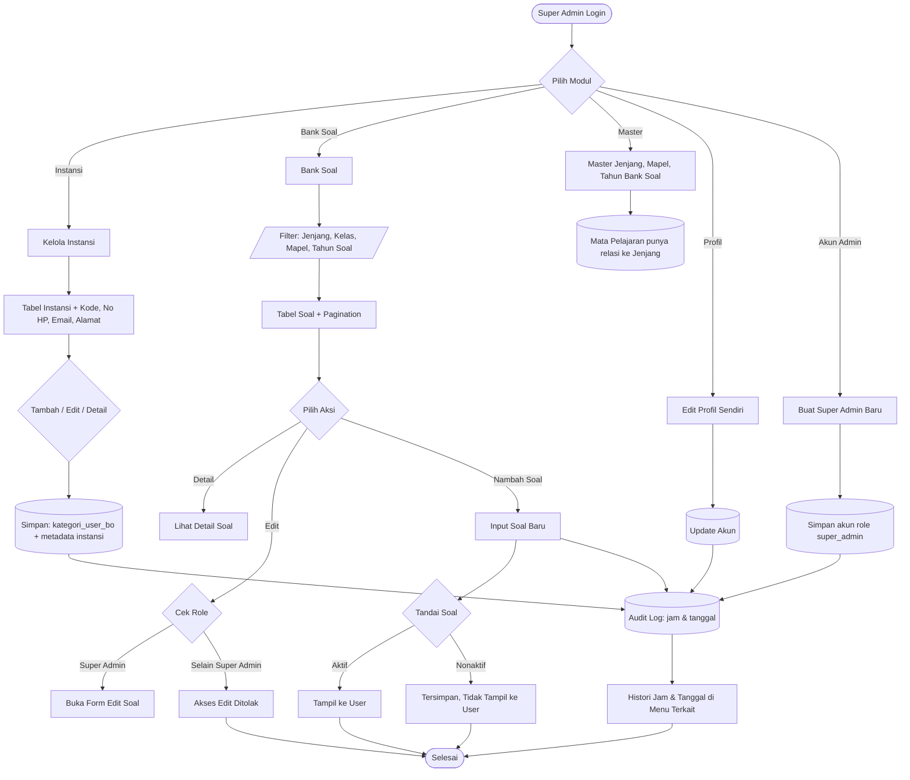

# Revisi Fitur Overall Flow CBT

Dokumen ini melengkapi [Overall_System_Flow_CBT.md](file:///d:/MAGANG/exam/Sistem-Ujian-Online/dokumentasi/Overall_System_Flow_CBT.md) dengan sepuluh penambahan fitur pada modul Super Admin, Bank Soal, dan profil pengguna. Alur ujian (guru, siswa, anti-cheat, auto-grading) tidak berubah.

## 1. Ringkasan Fitur

| No | Fitur | Perubahan |
| :--- | :--- | :--- |
| 1 | Kelola penggunaan instansi | Data instansi diperluas: no HP, email, alamat. |
| 2 | Hidden soal | Kolom `status` soal (aktif / nonaktif). Soal nonaktif tidak tampil ke user, rekaman tetap ada di database. |
| 3 | List & input bank soal | Filter jenjang, kelas, mata pelajaran, tahun soal + pagination + tombol detail dan edit satuan. |
| 4 | Kode instansi | Setiap instansi punya kode unik sebagai penentu. |
| 5 | Relasi master mata pelajaran | Mapel terhubung ke jenjang dan dipakai konsisten di bank soal. |
| 6 | Otoritas edit bank soal | Edit soal hanya untuk Super Admin. |
| 7 | Master tahun bank soal | Master data tahun sebagai atribut soal dan opsi filter. |
| 8 | Edit profil mandiri | Menu edit profil di semua dashboard (Super Admin, Admin, Guru, Siswa). |
| 9 | Buat Super Admin | Super Admin dapat membuat akun Super Admin baru dengan role sama. |
| 10 | Histori jam & tanggal | Pencatatan waktu pada create sekolah dan bank soal (dapat diperluas ke menu lain bila belum ada). |

## 2. Flow Mermaid

## 3. Catatan Teknis

- **Kode instansi (No. 4):** gunakan kolom unik pada `kategori_user_bo`, wajib diisi dan tidak boleh duplikat antar instansi.
- **Hidden soal (No. 2):** filter query soal default `status = aktif` untuk sisi user; panel bank soal menampilkan semua status dengan badge.
- **Otoritas edit (No. 6):** tombol edit pada tabel soal hanya dirender untuk role Super Admin dan divalidasi ulang di backend.
- **Master tahun (No. 7):** nilai tahun dipakai sebagai kolom tabel soal sekaligus sumber opsi dropdown filter.
- **Relasi mapel (No. 5):** mata pelajaran mengacu ke jenjang, sehingga filter bank soal per jenjang dan mapel konsisten.
- **Histori (No. 10):** cukup satu tabel audit log berisi entitas, aksi, aktor, dan timestamp. Menu yang sudah memiliki kolom waktu tidak ditambah lagi.
