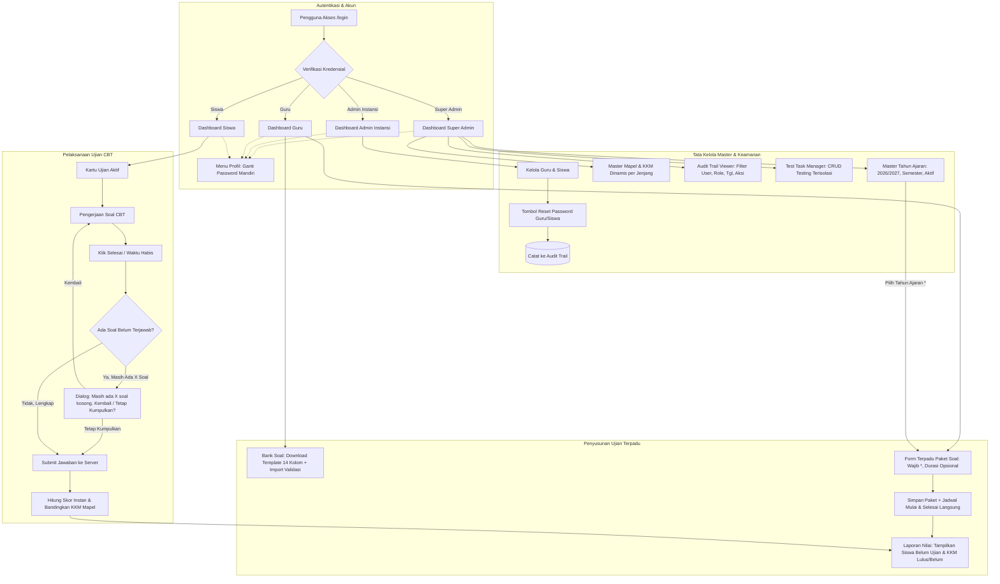

# Dokumentasi Pembaruan Arsitektur & Alur Sistem Ujian Online (11 Kebutuhan Sistem)

Dokumen ini disusun oleh Tim Senior System Analyst, Senior Laravel Developer, UI/UX Analyst, dan Database Architect sebagai acuan teknis pembaruan sistem CBT (*Computer-Based Testing*). Seluruh spesifikasi disesuaikan secara presisi dengan struktur database riil `sertidemi`, implementasi kode Laravel & React TypeScript yang berjalan, serta file alur `Copy of Overall System Flow.drawio.xml`.

---

## 1. Ringkasan Perubahan Arsitektur & Bisnis Proses

Pembaruan mencakup 11 modul utama tanpa merusak fungsionalitas yang telah berjalan (*100% backward compatible*):

1. **Master Tahun Ajaran**:
   - Master data berjenjang tahun akademik (contoh: `2026/2027`, semester `Ganjil`/`Genap`, status `Aktif`/`Nonaktif`).
   - Melekat wajib sebagai relasi pada Paket Soal (`assessment`), Hasil Ujian (`assessment_siswa`), Guru Pengampu (`guru_mata_pelajaran`), dan filter laporan.
2. **KKM Dinamis (Multi-Tier)**:
   - KKM tidak lagi bernilai statis global 75. KKM dikonfigurasi per jenjang pendidikan dan mata pelajaran.
   - Dikelola oleh Admin Instansi dan Guru Pengampu mata pelajaran.
   - Evaluasi kelulusan otomatis menampilkan: Nilai Siswa, KKM Mapel, dan Status (*Lulus* / *Belum Lulus*).
3. **Audit Trail Komprehensif**:
   - Menangkap seluruh aktivitas: `LOGIN`, `LOGOUT`, `CREATE`, `UPDATE`, `DELETE`, `IMPORT`, `EXPORT`, `GENERATE_EXAM`, `UPLOAD_QUESTION`, `RESET_PASSWORD`, `CHANGE_PASSWORD`, `PUBLISH_EXAM`, `UNPUBLISH_EXAM`.
   - Data mencakup: ID & Role User, Nama Tabel, Target ID, Data Sebelum & Sesudah (*JSON Diff*), IP Address, User Agent, dan Timestamp.
   - Hak akses terbatas hanya untuk Super Admin dan Admin Instansi (terisolasi per instansi).
4. **Template Excel Import Soal & Validasi Ketat**:
   - Penyediaan tombol unduh template standar 14 kolom dilengkapi 1 baris contoh riil.
   - Validasi atomik per baris dengan respon error spesifik (nomor baris, nama kolom, dan penyebab kegagalan).
5. **Standarisasi Form Validasi**:
   - Indikator wajib isi (*) berwarna merah pada seluruh form.
   - Durasi pengerjaan ujian dibuat **OPSIONAL** (fleksibel; jika dikosongkan, ujian tidak dibatasi batas waktu menit/hitung mundur).
6. **Form Terpadu Paket Soal (*Unified Exam Scheduling*)**:
   - Pengaturan jadwal (Tanggal & Jam Mulai, Tanggal & Jam Selesai) disatukan langsung ke dalam Form Pembuatan/Edit Paket Soal (`assessment`).
   - Menghilangkan tahapan menu jadwal terpisah yang membingungkan alur kerja guru.
7. **Modul Test Task Manager**:
   - Ruang pengujian fungsionalitas internal (CRUD Task/Testing Todo) yang terisolasi penuh dari tabel transaksi ujian CBT.
8. **Visibilitas Siswa Belum Mengerjakan**:
   - Rekap nilai dan hasil ujian menampilkan 100% siswa yang terdaftar dalam rombel/kelas yang ditugaskan.
   - Siswa yang belum login/memulai tetap tercantum dengan status `"Belum Mengerjakan"`, Nilai: `0` / `-`, Progress: `0%`.
9. **Modal Dialog Peringatan Soal Kosong**:
   - Saat siswa menekan tombol "Kumpulkan / Selesai Ujian", sistem memvalidasi sisa soal belum terjawab.
   - Jika terdapat soal kosong, muncul dialog peringatan: *"Masih ada X soal yang belum dijawab. Apakah yakin ingin mengumpulkan?"* dengan pilihan `[Kembali ke Soal]` atau `[Tetap Kumpulkan]`.
10. **Ganti Password Mandiri**:
    - Tersedia di menu Profil Akun seluruh peran (*Super Admin, Admin Instansi, Guru, Siswa*).
    - Memerlukan verifikasi password lama sebelum menyimpan password baru.
11. **Reset Password Terpusat oleh Admin**:
    - Hanya Super Admin dan Admin Instansi yang memiliki wewenang mereset password akun Guru dan Siswa.
    - Siswa dan Guru tidak memiliki opsi reset mandiri (*no public forgot password*) demi keamanan institusi.
    - Setiap tindakan reset mencatat entri audit trail.

---

## 2. Pembaruan Flowchart Sistem (`Copy of Overall System Flow.drawio.xml`)

File diagram alur telah diperbarui secara *in-place* pada node konteks yang ada untuk menjaga kerapian visual 100% tanpa tumpang tindih (*zero collision & zero dangling edges*):

| Kebutuhan | ID Node Draw.io | Label & Konteks Pembaruan |
|---|---|---|
| **Tahun Ajaran** | `l1CPpWX7XCTXfb2HIBHk-175`<br>`l1CPpWX7XCTXfb2HIBHk-179` | **Master Tahun Ajaran & Tahun Soal**<br>CRUD Tahun Ajaran (`2026/2027`, Ganjil/Genap, Status Aktif) dengan relasi wajib ke Paket Soal & Filter Laporan. |
| **KKM Dinamis** | `l1CPpWX7XCTXfb2HIBHk-174`<br>`l1CPpWX7XCTXfb2HIBHk-178` | **Master Mata Pelajaran & KKM Dinamis**<br>Konfigurasi KKM per Jenjang & Mapel, dikelola Admin Instansi & Guru, menentukan ambang Lulus/Belum Lulus. |
| **Audit Trail** | `l1CPpWX7XCTXfb2HIBHk-145`<br>`l1CPpWX7XCTXfb2HIBHk-194` | **Menu Audit Trail Lengkap**<br>Global log viewer dengan filter User, Role, Tanggal, Aktivitas (Login, CRUD, Import, Generate, Reset Password). |
| **Template Soal** | `l1CPpWX7XCTXfb2HIBHk-184`<br>`jXDs9eMhGlA39kO6X-Dz-634` | **Download Template & Import Soal Excel**<br>Format 14 kolom + 1 baris contoh riil + pelaporan baris, kolom, dan pesan error saat import gagal. |
| **Form Validasi & Terpadu** | `jXDs9eMhGlA39kO6X-Dz-640`<br>`jXDs9eMhGlA39kO6X-Dz-646` | **Form Terpadu Paket Soal**<br>Semua field wajib bertanda (*), Durasi OPSIONAL, Jadwal Mulai & Selesai langsung melekat dalam 1 form pembuatan. |
| **Test Task Manager** | `l1CPpWX7XCTXfb2HIBHk-140`<br>`jXDs9eMhGlA39kO6X-Dz-596` | **Menu Test Task Manager**<br>Item navigasi ke-6 pada menu Admin untuk testing internal CRUD task tanpa mengotori data ujian CBT. |
| **Hasil Siswa Belum Ujian** | `jXDs9eMhGlA39kO6X-Dz-649`<br>`jXDs9eMhGlA39kO6X-Dz-608`<br>`jXDs9eMhGlA39kO6X-Dz-609` | **Laporan & Rekap Nilai Siswa**<br>Siswa belum ujian tetap tampil (Status: "Belum Mengerjakan", Nilai 0), Evaluasi KKM Mapel, Filter per Tahun Ajaran. |
| **Peringatan Soal Kosong** | `jXDs9eMhGlA39kO6X-Dz-723` | **Konfirmasi & Validasi Submit**<br>Rhombus evaluasi submit: Jika ada X butir belum dijawab, tampilkan konfirmasi [Kembali ke Soal] / [Tetap Kumpulkan]. |
| **Ganti Password Mandiri** | `l1CPpWX7XCTXfb2HIBHk-198` | **Menu Ganti Password Mandiri**<br>Tersedia untuk semua role via Profil (Password Lama, Baru, Konfirmasi). |
| **Reset Password Terpusat** | `jXDs9eMhGlA39kO6X-Dz-601`<br>`jXDs9eMhGlA39kO6X-Dz-603` | **Manajemen Akun Guru & Siswa oleh Admin**<br>Tombol aksi "Reset Password" terpusat untuk akun Guru dan Siswa + logging audit trail. |

### Diagram Alur Utuh Terintegrasi (Mermaid Flow)



---

## 3. Rekomendasi Skema Database & Relasi (DDL Laravel Migration)

Berdasarkan skema aktif MySQL `sertidemi`, berikut spesifikasi migrasi database:

### A. Tabel Baru: `master_tahun_ajaran`
```php
Schema::create('master_tahun_ajaran', function (Blueprint $table) {
    $table->id('idtahun_ajaran');
    $table->string('nama_tahun_ajaran', 50); // Contoh: "2026/2027"
    $table->enum('semester', ['Ganjil', 'Genap'])->default('Ganjil');
    $table->boolean('status_aktif')->default(false);
    $table->timestamps();
    
    $table->index(['status_aktif']);
});
```

### B. Tabel Baru: `kkm_mata_pelajaran` (Dinamis per Jenjang & Instansi)
```php
Schema::create('kkm_mata_pelajaran', function (Blueprint $table) {
    $table->id('idkkm');
    $table->unsignedBigInteger('idinstansi')->nullable();
    $table->unsignedBigInteger('idmapel');
    $table->unsignedBigInteger('idjenjang');
    $table->decimal('nilai_kkm', 5, 2)->default(75.00);
    $table->unsignedBigInteger('created_by')->nullable(); // iduser_bo
    $table->timestamps();

    $table->foreign('idinstansi')->references('idinstansi')->on('master_instansi')->onDelete('cascade');
    $table->foreign('idmapel')->references('idmapel')->on('master_mata_pelajaran')->onDelete('cascade');
    $table->foreign('idjenjang')->references('idjenjang')->on('master_jenjang')->onDelete('cascade');
    $table->unique(['idinstansi', 'idmapel', 'idjenjang'], 'kkm_instansi_mapel_jenjang_unique');
});
```

### C. Tabel Baru: `test_tasks` (Modul Testing Terisolasi)
```php
Schema::create('test_tasks', function (Blueprint $table) {
    $table->id('idtask');
    $table->string('title', 150);
    $table->text('description')->nullable();
    $table->enum('status', ['pending', 'in_progress', 'completed'])->default('pending');
    $table->enum('priority', ['low', 'medium', 'high'])->default('medium');
    $table->unsignedBigInteger('created_by')->nullable();
    $table->timestamps();
});
```

### D. Alter Tabel Terkait: Penambahan `idtahun_ajaran` & Durasi Nullable
```php
Schema::table('assessment', function (Blueprint $table) {
    $table->unsignedBigInteger('idtahun_ajaran')->nullable()->after('idinstansi');
    $table->integer('waktu_pengerjaan')->nullable()->change(); // Durasi opsional (nullable)
    
    $table->foreign('idtahun_ajaran')->references('idtahun_ajaran')->on('master_tahun_ajaran')->onDelete('set null');
});

Schema::table('guru_mata_pelajaran', function (Blueprint $table) {
    $table->unsignedBigInteger('idtahun_ajaran')->nullable()->after('idmapel');
    $table->foreign('idtahun_ajaran')->references('idtahun_ajaran')->on('master_tahun_ajaran')->onDelete('set null');
});
```

---

## 4. Daftar Endpoint API Backend Baru & Terbarukan

| Method | Endpoint | Hak Akses | Keterangan & Payload |
|---|---|---|---|
| `GET` | `/api/admin/tahun-ajaran` | Super Admin, Admin Instansi | List master tahun ajaran (filter status aktif) |
| `POST` | `/api/admin/tahun-ajaran` | Super Admin | Buat tahun ajaran baru (`nama_tahun_ajaran`, `semester`, `status_aktif`) |
| `PUT` | `/api/admin/tahun-ajaran/:id` | Super Admin | Update & toggle status aktif tahun ajaran |
| `GET` | `/api/admin/kkm` | Admin Instansi, Guru | List KKM dinamis per jenjang & mata pelajaran |
| `POST` | `/api/admin/kkm` | Admin Instansi, Guru | Set/Update nilai KKM (`idmapel`, `idjenjang`, `nilai_kkm`) |
| `GET` | `/api/admin/audit-logs` | Super Admin, Admin Instansi | Riwayat audit dengan query params: `user_id`, `role`, `start_date`, `end_date`, `action` |
| `GET` | `/api/teacher/questions/template` | Guru, Super Admin | Unduh file binary Excel template 14 kolom + contoh riil |
| `POST` | `/api/teacher/questions/import` | Guru, Super Admin | Unggah Excel soal; mengembalikan HTTP 422 JSON jika ada kesalahan baris/kolom |
| `POST` | `/api/teacher/exams` | Guru, Admin Instansi | Simpan form terpadu paket soal (`nama`, `mapel`, `tgl_mulai`, `tgl_selesai`, `durasi` null/int) |
| `GET` | `/api/teacher/exams/:id/reports` | Guru, Admin Instansi | Rekap nilai termasuk siswa "Belum Mengerjakan" + evaluasi KKM |
| `POST` | `/api/profile/change-password` | Semua Role | Ganti password mandiri (`current_password`, `new_password`, `new_password_confirmation`) |
| `POST` | `/api/admin/users/:id/reset-password`| Super Admin, Admin Instansi | Reset password akun Guru/Siswa ke default acak; memicu catatan audit trail |
| `GET/POST/PUT/DELETE` | `/api/admin/test-tasks` | Super Admin, Admin Instansi | Modul CRUD testing internal task |

---

## 5. Pembaruan Antarmuka & Interaksi Frontend (UI/UX)

1. **Form Input Berbintang (*) & Durasi Fleksibel**:
   - Seluruh label wajib diberi tanda asterik merah: `<label className="label">Nama Paket <span className="text-red-500">*</span></label>`.
   - Field `Durasi (Menit)` diberi label pendukung: *(Opsional - Kosongkan jika ujian tanpa batas waktu)*.
2. **Form Terpadu Paket Soal**:
   - Tab atau langkah terpisah antara "Buat Paket" dan "Atur Jadwal" dihilangkan.
   - Sesi waktu pengerjaan (`Tanggal & Jam Mulai` serta `Tanggal & Jam Selesai`) langsung berada dalam 1 kartu form pembuatan paket soal.
3. **Modal Dialog Peringatan Soal Kosong**:
   - Sebelum memanggil endpoint submit ujian, React state memeriksa array jawaban `answers`:
     $$\text{soalKosong} = \text{totalSoal} - \text{jumlahTerjawab}$$
   - Jika $\text{soalKosong} > 0$, modal interaktif muncul dengan visual badge kuning:
     - Pesan: *"Perhatian! Masih ada **{soalKosong}** butir soal yang belum Anda jawab."*
     - Tombol: `[Periksa Kembali Soal]` (menutup modal) dan `[Tetap Kumpulkan Sekarang]` (melakukan POST submit).
4. **Visibilitas Siswa Belum Mengerjakan pada Tabel Laporan**:
   - Siswa yang belum ujian ditampilkan dengan baris tabel lengkap:
     - Nama Siswa & NIS
     - Badge Status: `<span className="badge badge-warning">Belum Mengerjakan</span>`
     - Skor: `0` (atau `-`)
     - Status KKM: `<span className="badge badge-error">Belum Tuntas</span>`
5. **Aksi Reset Password Terpusat pada Baris Tabel Admin**:
   - Pada halaman `/admin/teachers` dan `/admin/students`, kolom aksi memiliki tombol `[Reset Password]`.
   - Menampilkan modal konfirmasi dengan password baru yang di-generate sistem secara aman, serta otomatis terekam di Audit Trail.

---

## 6. Matriks Role & Hak Akses

| Fitur / Modul | Super Admin | Admin Instansi | Guru | Siswa |
|---|:---:|:---:|:---:|:---:|
| **Master Tahun Ajaran** | Full CRUD | View & Select | View & Select | Read Only (Sesi Aktif) |
| **Konfigurasi Nilai KKM** | Full Control | Full Control (Instansi) | Atur KKM Mapel yang Diampu | View (Hasil Ujian) |
| **Audit Trail Viewer** | Seluruh Sistem | Terbatas Instansinya | Tidak Ada Akses | Tidak Ada Akses |
| **Download Template & Import Soal** | Ya | Ya (Monitoring) | Ya (Penyusunan) | Tidak |
| **Buat Paket Soal Terpadu** | Ya | Ya | Ya | Tidak |
| **Test Task Manager** | Full CRUD | Full CRUD | Tidak Ada Akses | Tidak Ada Akses |
| **Lihat Siswa Belum Ujian** | Ya | Ya | Ya | Hanya Hasil Sendiri |
| **Ganti Password Mandiri** | Ya (Profil) | Ya (Profil) | Ya (Profil) | Ya (Profil) |
| **Reset Password Pengguna Lain** | Ya (Semua) | Ya (Guru & Siswa Instansi) | Tidak | Tidak |

---

## 7. Spesifikasi Audit Trail & Logging

Format payload JSON yang disimpan ke kolom `metadata` pada tabel `audit_logs`:

```json
{
  "event": "RESET_PASSWORD",
  "actor": {
    "id": 1,
    "name": "Super Administrator",
    "role": "Super Admin"
  },
  "target": {
    "type": "user_siswa",
    "id": 142,
    "label": "Budi Santoso (NIS: 20261001)"
  },
  "ip_address": "192.168.1.50",
  "user_agent": "Mozilla/5.0 (Windows NT 10.0; Win64; x64) Chrome/120.0.0.0",
  "changes": {
    "before": { "password_hash": "$2y$12$oldhash..." },
    "after": { "password_hash": "$2y$12$newhash...", "reset_by": "admin" }
  },
  "timestamp": "2026-10-23T14:15:00+07:00"
}
```

---

## 8. Panduan Template Import Soal Excel

Format file Excel `.xlsx` terdiri dari 14 kolom wajib:

| No | Nama Kolom | Tipe Data | Keterangan & Contoh Valid |
|---|---|---|---|
| 1 | `Mata Pelajaran` | Teks | Kode/Nama Mapel (Contoh: `MATEMATIKA`) |
| 2 | `Jenjang` | Teks | Jenjang Pendidikan (Contoh: `SMA`) |
| 3 | `Bab / Topik` | Teks | Pokok bahasan (Contoh: `Trigonometri`) |
| 4 | `Tingkat Kesulitan` | Enum | Pilihan: `Mudah`, `Sedang`, `Sulit` |
| 5 | `Pertanyaan` | Teks / HTML | Redaksi butir soal (Contoh: `Nilai dari sin 30 derajat adalah...`) |
| 6 | `Pilihan A` | Teks | Opsi A (Contoh: `0`) |
| 7 | `Pilihan B` | Teks | Opsi B (Contoh: `1/2`) |
| 8 | `Pilihan C` | Teks | Opsi C (Contoh: `1/2 akar 2`) |
| 9 | `Pilihan D` | Teks | Opsi D (Contoh: `1/2 akar 3`) |
| 10 | `Pilihan E` | Teks | Opsi E opsional (Contoh: `1`) |
| 11 | `Kunci Jawaban` | Karakter | Huruf kapital: `A`, `B`, `C`, `D`, atau `E` |
| 12 | `Pembahasan` | Teks | Solusi pembahasan soal |
| 13 | `Bobot Nilai` | Angka | Skor butir soal (Contoh: `1.00`) |
| 14 | `Status Aktif` | Enum / Boolean | `1` atau `Aktif` |

### Baris Contoh Riil (Row 2 Template):
`MATEMATIKA | SMA | Trigonometri | Mudah | Nilai dari sin 30 derajat adalah... | 0 | 1/2 | 1/2 akar 2 | 1/2 akar 3 | 1 | B | Berdasarkan tabel sudut istimewa sin 30 = 0.5 (1/2) | 1.00 | 1`

### Respon Error Detail Validasi Import (JSON 422):
```json
{
  "success": false,
  "message": "Validasi berkas soal gagal. Silakan periksa detail baris berikut.",
  "errors": [
    {
      "baris": 5,
      "kolom": "Kunci Jawaban",
      "nilai_input": "F",
      "alasan": "Kunci jawaban harus berupa salah satu dari opsi A, B, C, D, atau E."
    },
    {
      "baris": 8,
      "kolom": "Pertanyaan",
      "nilai_input": "",
      "alasan": "Field pertanyaan butir soal wajib diisi dan tidak boleh kosong."
    }
  ]
}
```

---

## 9. Error Handling & Edge Cases

1. **Ujian Tanpa Batas Durasi (`waktu_pengerjaan = null`)**:
   - Timer hitung mundur pada antarmuka siswa dinonaktifkan / diganti dengan durasi berjalan (*elapsed time*). Ujian hanya dibatasi oleh `tanggal_batas_assessment`.
2. **Siswa Mencoba Reset Mandiri**:
   - Tidak ada rute API `/api/auth/forgot-password`. Request eksternal langsung ditolak dengan `403 Forbidden: Reset password hanya dapat dilakukan melalui Administrator Instansi`.
3. **Filter Laporan Tanpa Siswa Mengerjakan**:
   - Jika suatu kelas belum ada siswa yang mengerjakan sama sekali, query `LEFT JOIN` dari tabel `user_siswa` ke `assessment_siswa` menjamin seluruh nama siswa tetap muncul dengan status "Belum Mengerjakan" dan nilai 0.

---

## 10. Checklist Implementasi Langkah demi Langkah

- [x] **Draw.io Flowchart**: Sinkronisasi in-place `Copy of Overall System Flow.drawio.xml` dengan layout rapi dan bersih.
- [ ] **Database Migration**: Eksekusi migration tabel `master_tahun_ajaran`, `kkm_mata_pelajaran`, `test_tasks`, dan alter `assessment`.
- [ ] **Backend Controllers**:
  - [ ] Implementasi `TahunAjaranController` dan middleware filter tahun ajaran aktif.
  - [ ] Implementasi KKM dinamis pada `TeacherExamController` dan `ResultController`.
  - [ ] Peningkatan `AuditTrailController` untuk mencatat event reset password dan perubahan paket.
  - [ ] Parser service Excel template 14 kolom dengan pelaporan error baris & kolom.
- [ ] **Frontend React**:
  - [ ] Bintang merah (*) pada form paket dan durasi opsional.
  - [ ] Modal konfirmasi soal kosong saat submit pada `ExamSessionPage.tsx`.
  - [ ] Kolom KKM, status tuntas, dan baris siswa "Belum Mengerjakan" pada laporan ujian.
  - [ ] Tombol Reset Password pada tabel guru & siswa admin.
  - [ ] Menu Navigasi `Test Task Manager`.
